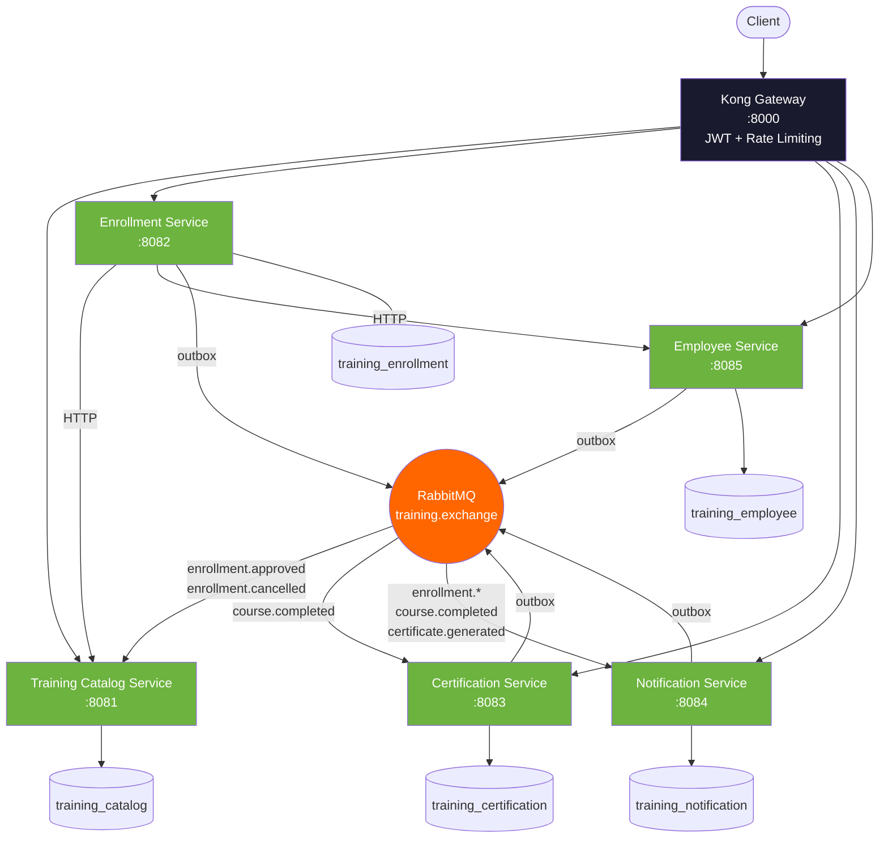
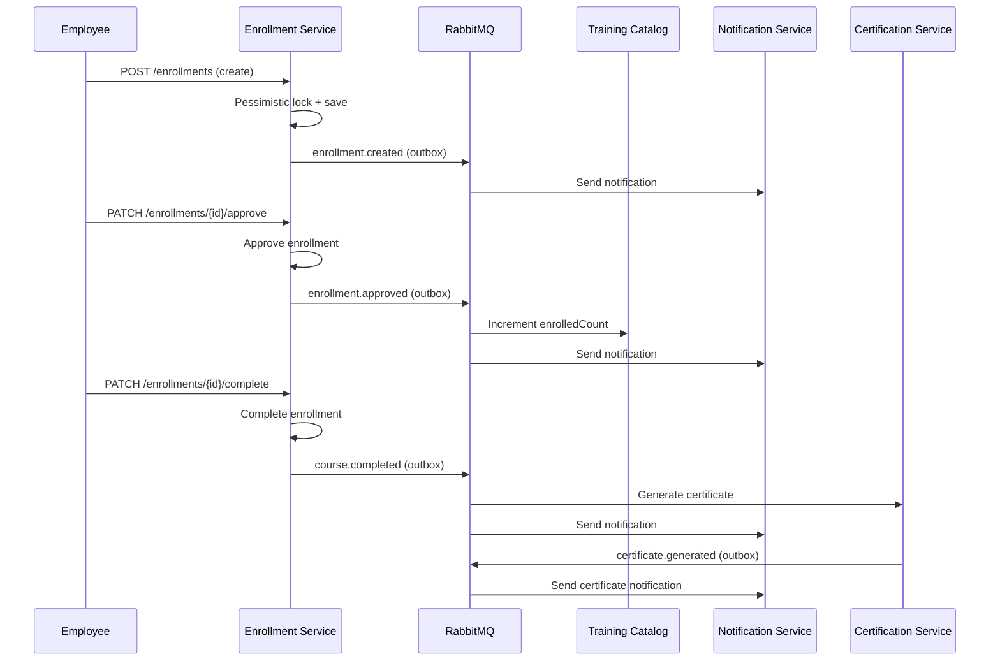
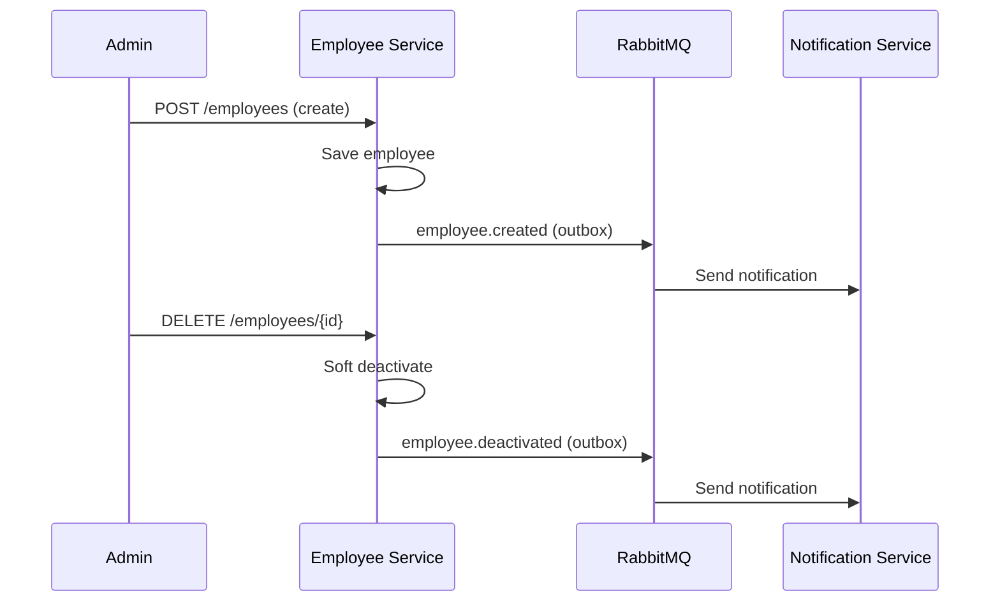
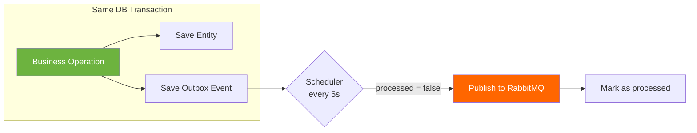
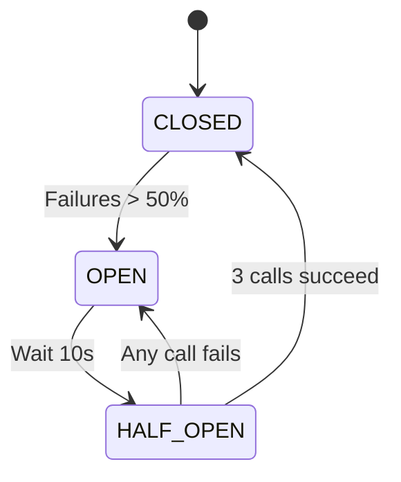
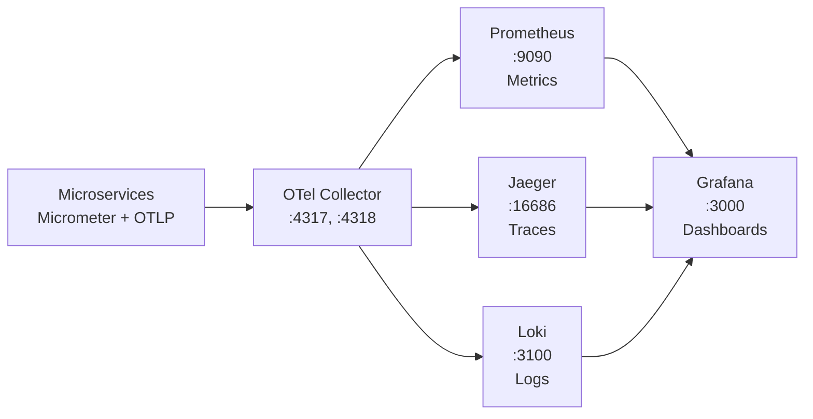
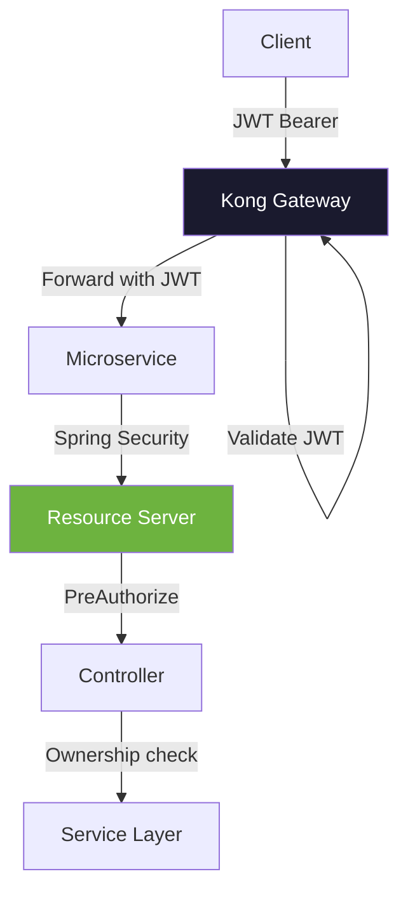
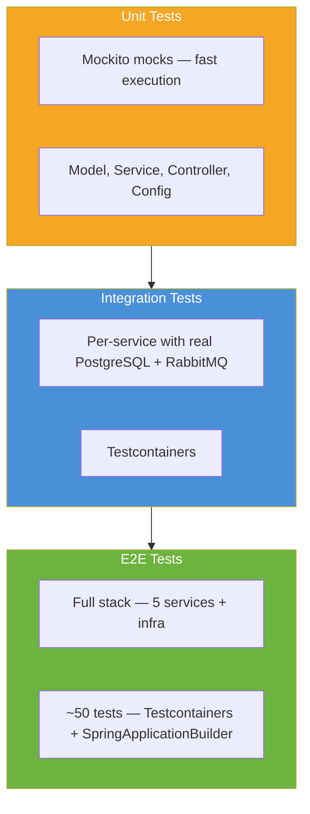

# Training Platform — Spring Boot Microservices Architecture

[](https://openjdk.org/projects/jdk/21/)
[](https://spring.io/projects/spring-boot)
[](#coverage-report)
[](LICENSE)

Cloud-native microservices architecture for corporate training management.
Built with Spring Boot 4, Kubernetes, Kong Gateway, Keycloak, RabbitMQ and OpenTelemetry — achieving 100% test coverage across all services.

---

## Why Spring Boot?

Spring Boot was chosen as the foundation for this POC after evaluating several alternatives. The decision was driven by the specific demands of a microservices architecture targeting production-grade patterns.

### Ecosystem Maturity

Spring Boot has the most mature ecosystem for building microservices in the JVM world. Spring Cloud provides battle-tested solutions for service discovery, configuration management, circuit breakers, and distributed tracing — all concerns that arise immediately when moving from a monolith to microservices. No other JVM framework offers this level of integrated infrastructure support out of the box.

### Reactive and Non-Blocking

Spring WebFlux enables high-concurrency request handling without blocking threads. The Enrollment Service uses `WebClient` (reactive HTTP client) for downstream calls to Employee and Training Catalog services, allowing the service to handle hundreds of concurrent requests without thread pool exhaustion. This is critical for a service that orchestrates multiple synchronous calls with resilience patterns.

### Spring Cloud Integration

Resilience4j integrates seamlessly with Spring Boot via Spring Cloud, providing circuit breaker and retry patterns with annotation-driven configuration (`@CircuitBreaker`, `@Retry`). This eliminates the need for custom resilience implementations and ensures consistent behavior across services.

### Database-per-Service Pattern

Spring Data JPA with Flyway migrations makes the database-per-service pattern straightforward. Each microservice owns its database schema, and Flyway ensures reproducible, version-controlled migrations. PostgreSQL was chosen over MongoDB because the domain is highly relational (courses, enrollments, employees, certificates with foreign key relationships) and ACID transactions are required for the outbox pattern.

### Testcontainers Integration

Spring Boot's native support for Testcontainers allows integration tests to spin up real PostgreSQL and RabbitMQ containers, ensuring tests run against the same infrastructure as production. This is how the project achieves 100% test coverage with meaningful integration tests — not just mocked interactions.

### Why Not Alternatives?

| Alternative | Why Spring Boot was preferred |
|---|---|
| **Quarkus** | Smaller community, fewer production case studies, less mature Spring Cloud integration |
| **Micronaut** | Compile-time DI is innovative but lacks the ecosystem depth of Spring |
| **Node.js / Express** | No type safety, weaker concurrency model for CPU-bound operations, less mature security ecosystem |
| **Go / Gin** | Excellent performance but smaller developer pool for enterprise Java shops, no equivalent to Spring Data JPA |
| **.NET** | Strong platform but higher licensing costs and less flexibility in cloud-native tooling |

---

## Architecture

### System Architecture



### Architectural Style

This project follows a **Microservices Architecture** with **Event-Driven Communication**:

- **Services are independently deployable** with their own database (Database-per-Service pattern)
- **Synchronous communication** (REST/HTTP) is used only when an immediate response is required (e.g., seat validation)
- **Asynchronous communication** (RabbitMQ events) is the default for decoupled, resilient inter-service interaction
- **Transactional Outbox pattern** guarantees reliable event publishing without distributed transactions

### Databases (Database-per-Service)

| Service | Database | Purpose |
|---|---|---|
| Training Catalog | `training_catalog` | Course catalog |
| Enrollment | `training_enrollment` | Employee enrollments |
| Certification | `training_certification` | Issued certificates |
| Notification | `training_notification` | Notification history |
| Employee | `training_employee` | Employee records |

---

## Microservices

### Training Catalog Service (Port 8081)

**Purpose**: Manages the course catalog.

| Aspect | Detail |
|---|---|
| **Responsibilities** | CRUD operations for courses, course capacity management, course status management |
| **Event Consumer** | `enrollment.approved` (increments enrolledCount), `enrollment.cancelled` (decrements enrolledCount) |
| **Idempotency** | `ProcessedEvent` table prevents duplicate event processing |
| **Database** | `training_catalog` (Flyway migrations: V1-courses, V2-processed_events) |

**Endpoints**:
```
GET    /api/v1/courses                 - List courses (filterable, paginated, sortable)
GET    /api/v1/courses/active          - Get active courses
GET    /api/v1/courses/{id}            - Get course by ID
POST   /api/v1/courses                 - Create course                    [admin]
PUT    /api/v1/courses/{id}            - Update course                    [instructor, admin]
DELETE /api/v1/courses/{id}            - Deactivate course (soft delete)  [admin]
PATCH  /api/v1/courses/{id}/complete   - Mark course as completed         [instructor, admin]
PATCH  /api/v1/courses/{id}/seats/increment - Increment enrolled count   [instructor, admin]
PATCH  /api/v1/courses/{id}/seats/decrement - Decrement enrolled count   [instructor, admin]
```

---

### Enrollment Service (Port 8082)

**Purpose**: Manages employee enrollments in courses.

| Aspect | Detail |
|---|---|
| **Responsibilities** | Employee enrollment, seat availability validation, enrollment lifecycle (approve/reject/complete/cancel) |
| **Event Producer** | `enrollment.created`, `enrollment.approved`, `enrollment.rejected`, `enrollment.cancelled`, `course.completed` |
| **Synchronous Calls** | Employee Service (existence check), Training Catalog Service (course validation + seat management) |
| **Resilience** | Circuit Breaker + Retry via Resilience4j on downstream HTTP calls |
| **Locking** | Pessimistic lock on enrollment creation (prevents duplicate enrollment) |
| **Token Relay** | Propagates JWT to downstream services via WebClient filter |
| **Database** | `training_enrollment` (Flyway migrations: V1-enrollments, V2-outbox_events) |

**Endpoints**:
```
GET    /api/v1/enrollments/active/{employeeId}  - Check active enrollments     [admin, instructor]
GET    /api/v1/enrollments?employeeId=X          - List enrollments (paginated) [employee*, instructor, admin]
GET    /api/v1/enrollments/{id}                  - Get enrollment               [employee*, instructor, admin]
POST   /api/v1/enrollments?employeeId=X&courseId=Y - Create enrollment          [employee*, instructor, admin]
PATCH  /api/v1/enrollments/{id}/approve          - Approve enrollment           [instructor, admin]
PATCH  /api/v1/enrollments/{id}/complete         - Complete enrollment          [instructor, admin]
PATCH  /api/v1/enrollments/{id}/reject           - Reject enrollment            [instructor, admin]
PATCH  /api/v1/enrollments/{id}/cancel           - Cancel enrollment            [employee*, instructor, admin]
```
> \* Employees can only access their own enrollments (ownership verification).

---

### Certification Service (Port 8083)

**Purpose**: Automatically generates certificates when courses are completed.

| Aspect | Detail |
|---|---|
| **Responsibilities** | Certificate generation, certificate number sequencing, certificate validation |
| **Event Consumer** | `course.completed` (auto-generates certificate) |
| **Event Producer** | `certificate.generated` |
| **Idempotency** | Checks for existing certificate + catches DataIntegrityViolationException |
| **Certificate Number** | Format `CERT-YYYYMMDD-NNNNNN` using PostgreSQL sequence |
| **Database** | `training_certification` (Flyway migrations: V1-certificates, V2-outbox_events, V3-certificate_number_seq) |

**Endpoints**:
```
GET    /api/v1/certificates?employeeId=X         - List certificates by employee [employee*, instructor, admin]
GET    /api/v1/certificates/{id}                  - Get certificate              [employee*, instructor, admin]
GET    /api/v1/certificates/number/{number}       - Get by certificate number    [employee*, instructor, admin]
```
> \* Employees can only access their own certificates (ownership verification).

---

### Notification Service (Port 8084)

**Purpose**: Sends notifications for all business events.

| Aspect | Detail |
|---|---|
| **Responsibilities** | Listen to business events via RabbitMQ, send notifications, store notification history |
| **Event Consumers** | `enrollment.created`, `enrollment.approved`, `enrollment.rejected`, `enrollment.cancelled`, `course.completed`, `certificate.generated` |
| **Idempotency** | Triple check: `isAlreadyProcessed()` + `DataIntegrityViolationException` catch + `existsByReferenceIdAndReferenceTypeAndType` |
| **Strategy Pattern** | `SimulatedNotificationSender` (local/test) / `EmailNotificationSender` (email profile) |
| **Database** | `training_notification` (Flyway migrations: V1-notifications, V2-unique_constraint, V3-processed_events, V4-outbox_events) |

**Endpoints**:
```
GET    /api/v1/notifications?recipientId=X  - List notifications (paginated) [employee*, instructor, admin]
GET    /api/v1/notifications/{id}            - Get notification               [employee*, instructor, admin]
```
> \* Employees can only access their own notifications (ownership verification).

---

### Employee Service (Port 8085)

**Purpose**: Manages employee records.

| Aspect | Detail |
|---|---|
| **Responsibilities** | CRUD operations for employees, employee lookup and existence validation |
| **Event Producer** | `employee.created`, `employee.updated`, `employee.deactivated` |
| **Synchronous Calls** | Checks active enrollments before deactivation |
| **Soft Delete** | Deactivation sets `active=false` instead of physical deletion |
| **Database** | `training_employee` (Flyway migrations: V001-employees, V2-outbox_events) |

**Endpoints**:
```
GET    /api/v1/employees                    - List employees (paginated, sortable) [instructor, admin]
GET    /api/v1/employees/{id}                - Get employee by ID                   [employee, instructor, admin]
GET    /api/v1/employees/number/{empNumber}  - Get employee by number               [instructor, admin]
GET    /api/v1/employees/{id}/exists         - Check employee existence             [employee, instructor, admin]
POST   /api/v1/employees                     - Create employee                      [admin]
PUT    /api/v1/employees/{id}                - Update employee                      [admin]
DELETE /api/v1/employees/{id}                - Deactivate employee (soft delete)    [admin]
```

---

## API Endpoints

| Method | Endpoint | Service | Auth |
|---|---|---|---|
| `GET` | `/api/v1/courses` | Training Catalog | employee, instructor, admin |
| `GET` | `/api/v1/courses/active` | Training Catalog | employee, instructor, admin |
| `GET` | `/api/v1/courses/{id}` | Training Catalog | employee, instructor, admin |
| `POST` | `/api/v1/courses` | Training Catalog | admin |
| `PUT` | `/api/v1/courses/{id}` | Training Catalog | instructor, admin |
| `DELETE` | `/api/v1/courses/{id}` | Training Catalog | admin |
| `PATCH` | `/api/v1/courses/{id}/complete` | Training Catalog | instructor, admin |
| `PATCH` | `/api/v1/courses/{id}/seats/increment` | Training Catalog | instructor, admin |
| `PATCH` | `/api/v1/courses/{id}/seats/decrement` | Training Catalog | instructor, admin |
| `GET` | `/api/v1/enrollments` | Enrollment | employee*, instructor, admin |
| `GET` | `/api/v1/enrollments/active/{empId}` | Enrollment | admin, instructor |
| `GET` | `/api/v1/enrollments/{id}` | Enrollment | employee*, instructor, admin |
| `POST` | `/api/v1/enrollments` | Enrollment | employee*, instructor, admin |
| `PATCH` | `/api/v1/enrollments/{id}/approve` | Enrollment | instructor, admin |
| `PATCH` | `/api/v1/enrollments/{id}/complete` | Enrollment | instructor, admin |
| `PATCH` | `/api/v1/enrollments/{id}/reject` | Enrollment | instructor, admin |
| `PATCH` | `/api/v1/enrollments/{id}/cancel` | Enrollment | employee*, instructor, admin |
| `GET` | `/api/v1/certificates` | Certification | employee*, instructor, admin |
| `GET` | `/api/v1/certificates/{id}` | Certification | employee*, instructor, admin |
| `GET` | `/api/v1/certificates/number/{num}` | Certification | employee*, instructor, admin |
| `GET` | `/api/v1/notifications` | Notification | employee*, instructor, admin |
| `GET` | `/api/v1/notifications/{id}` | Notification | employee*, instructor, admin |
| `GET` | `/api/v1/employees` | Employee | instructor, admin |
| `GET` | `/api/v1/employees/{id}` | Employee | employee, instructor, admin |
| `GET` | `/api/v1/employees/number/{num}` | Employee | instructor, admin |
| `GET` | `/api/v1/employees/{id}/exists` | Employee | employee, instructor, admin |
| `POST` | `/api/v1/employees` | Employee | admin |
| `PUT` | `/api/v1/employees/{id}` | Employee | admin |
| `DELETE` | `/api/v1/employees/{id}` | Employee | admin |

> \* Ownership verification: employees can only access their own resources.

---

## Business Events

### Event Catalog

| Event | Producer | Consumer(s) | Routing Key |
|---|---|---|---|
| `EnrollmentCreated` | Enrollment Service | Notification Service | `enrollment.created` |
| `EnrollmentApproved` | Enrollment Service | Notification Service, Training Catalog Service | `enrollment.approved` |
| `EnrollmentRejected` | Enrollment Service | Notification Service | `enrollment.rejected` |
| `EnrollmentCancelled` | Enrollment Service | Notification Service, Training Catalog Service | `enrollment.cancelled` |
| `CourseCompleted` | Enrollment Service | Certification Service, Notification Service | `course.completed` |
| `CertificateGenerated` | Certification Service | Notification Service | `certificate.generated` |
| `EmployeeCreated` | Employee Service | Notification Service | `employee.created` |
| `EmployeeUpdated` | Employee Service | Notification Service | `employee.updated` |
| `EmployeeDeactivated` | Employee Service | Notification Service | `employee.deactivated` |

### Event Flow Diagrams

#### Enrollment Lifecycle



#### Employee Lifecycle



---

## Architecture Patterns

### Transactional Outbox Pattern

**Used by**: Enrollment, Employee, Certification, Notification services.

**Problem**: Publishing events to RabbitMQ in the same transaction as business data risks inconsistency — if the publish fails, the event is lost; if it succeeds but the transaction rolls back, a phantom event is sent.

**Solution**: Events are persisted to an `outbox_events` table within the same DB transaction as the business operation. A scheduler (`OutboxEventScheduler`) polls for unprocessed events every 5 seconds and publishes them to RabbitMQ.



**Guarantee**: At-least-once delivery. Consumers must be idempotent.

---

### Circuit Breaker + Retry (Resilience4j)

**Used by**: Enrollment Service for synchronous calls to Employee Service and Training Catalog Service.

| Parameter | Value |
|---|---|
| Sliding window size | 10 calls |
| Failure rate threshold | 50% |
| Wait duration in open state | 10 seconds |
| Permitted calls in half-open state | 3 |
| Retry max attempts | 3 |
| Retry wait duration | 500ms |



**Fallback**: Throws `ServiceUnavailableException` (HTTP 503) when the circuit is open.

---

### Idempotent Event Consumption

**Used by**: Training Catalog Service (`processed_events` table), Notification Service (`processed_events` table).

**Problem**: At-least-once delivery means consumers may receive duplicate events.

**Solution**: Each consumed event is checked against a `processed_events` table. If the event ID already exists, it is skipped. Concurrent duplicate processing is caught via `DataIntegrityViolationException`.

```java
// 1. Check if already processed
if (processedEventRepository.existsById(event.getEventId())) {
    log.warn("Event already processed: {}", event.getEventId());
    return;
}
// 2. Process + persist marker in same transaction
processedEventRepository.save(new ProcessedEvent(event.getEventId(), event.getEventType()));
// 3. Business logic...
```

---

### Optimistic Locking

**Used by**: Enrollment entity (`@Version` field).

Detects concurrent modifications by comparing a version number. If another transaction modified the same row, an `OptimisticLockException` is thrown and the operation fails safely.

---

### Pessimistic Locking

**Used by**: Enrollment creation (`@Lock(LockModeType.PESSIMISTIC_WRITE)`).

Acquires a database lock on the query result before processing, preventing two concurrent transactions from enrolling the same employee in the same course.

---

### Atomic Seat Management

**Used by**: Training Catalog Service (`incrementEnrolledCountIfAvailable` / `decrementEnrolledCount`).

Uses repository-level JPQL with conditional updates:
```sql
UPDATE Course c SET c.enrolledCount = c.enrolledCount + 1
WHERE c.id = :courseId AND c.enrolledCount < c.capacity
```

---

### Soft Delete

**Used by**: Employee and Course entities.

Instead of physical deletion, records are marked as inactive (`active = false`). This preserves data integrity for foreign key references and maintains audit history.

---

### Strategy Pattern

**Used by**: Notification Service.

```mermaid
flowchart LR
    A[NotificationSender<br/>interface] --> B[SimulatedNotificationSender<br/>@Profile: local, test]
    A --> C[EmailNotificationSender<br/>@Profile: email]
    B --> D[Log the notification]
    C --> E[Send via JavaMailSender]
```

---

### Token Relay

**Used by**: Enrollment Service for downstream HTTP calls.

The `WebClientConfig` adds a `tokenRelayFilter()` that extracts the `Authorization` header from the incoming servlet request and propagates it to outbound WebClient calls, maintaining the caller's identity across services.

---

### Sort Field Whitelisting

**Used by**: All controllers with sortable endpoints.

Sort parameters are validated against a hardcoded `ALLOWED_SORT_FIELDS` set to prevent JPQL injection via malicious sort values.

---

## Infrastructure

### Docker Compose (Local Development)

9 containers on `training-network` bridge:

| Service | Image | Ports | Purpose |
|---|---|---|---|
| PostgreSQL | postgres:16-alpine | 5432 | Primary database |
| Keycloak | quay.io/keycloak/keycloak:24.0.1 | 8080 | Identity Provider |
| RabbitMQ | rabbitmq:3.13-management-alpine | 5672, 15672 | Message Broker |
| Kong | kong:3.6 | 8000, 8001 | API Gateway |
| Prometheus | prom/prometheus:v2.50.0 | 9090 | Metrics |
| Grafana | grafana/grafana:10.3.1 | 3000 | Dashboards |
| Loki | grafana/loki:2.9.4 | 3100 | Log Aggregation |
| Jaeger | jaegertracing/all-in-one:1.54 | 16686 | Distributed Tracing |
| OTel Collector | otel/opentelemetry-collector-contrib:0.94.0 | 4317, 4318 | Telemetry Pipeline |

Persistent volumes: `postgresql_data`, `rabbitmq_data`, `prometheus_data`, `grafana_data`, `loki_data`.

### Kubernetes (Production)

All resources deployed to the `training-platform` namespace:

| Component | Kind | Replicas | Service Type |
|---|---|---|---|
| PostgreSQL | StatefulSet | 1 | ClusterIP |
| Keycloak | Deployment | 1 | ClusterIP |
| RabbitMQ | Deployment | 1 | ClusterIP |
| Kong | Deployment | 1 | NodePort |
| 5 Microservices | Deployment | 2 each | ClusterIP |
| Prometheus | Deployment | 1 | ClusterIP |
| Grafana | Deployment | 1 | ClusterIP |
| Jaeger | Deployment | 1 | ClusterIP |
| Loki | Deployment | 1 | ClusterIP |
| OTel Collector | Deployment | 1 | ClusterIP |

**Microservice resources**: 256Mi-512Mi memory, 250m-500m CPU.

**Health probes**: Liveness + Readiness on `/actuator/health` for all microservices.

**HPA**: min=2, max=10 replicas, CPU 70% / Memory 80% targets.

**Config per service**: ConfigMap (datasource URL, RabbitMQ host, JWT issuer URI) + Secret (passwords, credentials).

### Keycloak

| Aspect | Detail |
|---|---|
| **Realm** | `training-realm` |
| **Protocol** | OAuth2/OIDC with JWT |
| **Brute Force Protection** | Enabled (5 failures, 900s lockout) |
| **Service Clients** | 5 (one per microservice, client-secret auth) |
| **Frontend Client** | `training-frontend` (standard flow, redirect to localhost:3000) |
| **Custom Claim** | `employeeId` mapped via protocol mapper |

### Kong Gateway

| Plugin | Configuration |
|---|---|
| **JWT** | Validates Bearer tokens, verifies `exp` claim, uses `iss` as key |
| **Rate Limiting** | 100 requests/minute per consumer, local policy |
| **CORS** | Allows `localhost:3000` and `localhost:5173` |

**Routes**:

| Path | Service | Methods |
|---|---|---|
| `/api/v1/courses` | Training Catalog | GET, POST, PUT, DELETE, PATCH |
| `/api/v1/enrollments` | Enrollment | GET, POST, PATCH |
| `/api/v1/certificates` | Certification | GET |
| `/api/v1/notifications` | Notification | GET |
| `/api/v1/employees` | Employee | GET, POST, PUT, DELETE |

### RabbitMQ

| Component | Detail |
|---|---|
| **Exchange** | `training.exchange` (topic, durable) |
| **Queues** | `enrollment.created`, `enrollment.approved`, `enrollment.rejected`, `enrollment.cancelled`, `course.completed`, `certificate.generated`, `employee.created`, `employee.deactivated`, `notification.sent` |
| **Dead Letter Queues** | `catalog.dlq`, `certification.dlq`, `notification.dlq` |
| **Management UI** | http://localhost:15672 |

---

## Observability



### Prometheus (Metrics)

- **Scrape interval**: 15s
- **Targets**: All microservices via `/actuator/prometheus`
- **Alert rules**:
  - `ServiceDown` (critical) — service unreachable for 1m
  - `HighErrorRate` (warning) — 5xx error rate > 0.1 req/s for 2m
  - `HighLatency` (warning) — P95 latency > 2s for 2m
  - `HighHeapMemory` (warning) — heap usage > 85% for 5m
  - `CircuitBreakerOpen` (critical) — Resilience4j circuit breaker open for 1m

### Jaeger (Distributed Tracing)

- **Protocol**: OpenTelemetry OTLP (gRPC:4317, HTTP:4318)
- **UI**: http://localhost:16686
- **Purpose**: End-to-end request tracing across microservices

### Loki (Log Aggregation)

- **Integration**: OTel Collector exports logs to Loki
- **Retention**: 7 days (168h)
- **Purpose**: Centralized, searchable log storage

### Grafana (Dashboards)

- **Datasources**: Prometheus (default), Jaeger, Loki
- **Pre-provisioned dashboard**: Training Platform Dashboard with JVM Memory, HTTP Requests, Request Duration, and JVM Threads panels

---

## Security



### Authentication

| Aspect | Detail |
|---|---|
| **Provider** | Keycloak |
| **Protocol** | OAuth2/OIDC |
| **Token Type** | JWT (signed by Keycloak) |
| **Validation** | Each service acts as a Resource Server, validating JWT signature and claims |
| **Gateway** | Kong also validates JWTs before routing |

### Authorization (RBAC)

| Role | Permissions |
|---|---|
| **admin** | Full access: create/update/delete all resources, manage employees |
| **instructor** | View courses, update courses, approve/reject/complete enrollments |
| **employee** | View courses, enroll self, view own enrollments/certificates/notifications, cancel own enrollment |

### Data-Level Access Control

- Enrollment, Certificate, and Notification controllers verify that **employee-role users can only access their own resources**
- Employee ID is extracted from the `employeeId` JWT claim (custom protocol mapper in Keycloak)
- Implemented via `JwtUtils.isEmployeeOnly()` and `JwtUtils.extractEmployeeIdAsLong()`

---

## Testing

### Test Pyramid



### Unit Tests

Located in `src/test/java/` for each service:
- **Model tests**: `EmployeeTest`, `EnrollmentTest`, `CourseTest`, `CertificateTest`, `NotificationTest`, `OutboxEventTest`, `ProcessedEventTest`
- **DTO tests**: `EmployeeRequestTest`, `EmployeeResponseTest`, `EnrollmentRequestTest`, `EnrollmentResponseTest`, `CertificateResponseTest`
- **Service tests**: `EmployeeServiceTest`, `CourseServiceTest`, `EnrollmentServiceTest`, `CertificationServiceTest`, `NotificationServiceTest`
- **Controller tests**: `CourseControllerTest`, `EnrollmentControllerTest`, `CertificateControllerTest`, `NotificationControllerTest`
- **Client tests**: `EnrollmentClientTest`, `EmployeeClientTest`, `TrainingCatalogClientTest`
- **Config tests**: `SecurityConfigTest`, `RabbitMQConfigTest`, `JacksonConfigTest`, `WebClientConfigTest`
- **Shared module**: `OutboxEventSchedulerTest`, `Jackson3JsonMessageConverterTest`, `KeycloakJwtConverterTest`, `JwtUtilsTest`, `GlobalExceptionHandlerTest`

### Integration Tests

Each service has dedicated integration tests using **Testcontainers**:
- `EmployeeControllerIntegrationTest`, `EmployeeServiceIntegrationTest`, `EmployeeSecurityIntegrationTest`
- `CourseControllerIntegrationTest`, `CourseServiceIntegrationTest`
- `EnrollmentControllerIntegrationTest`, `EnrollmentFlowIntegrationTest`, `OutboxEventSchedulerIntegrationTest`
- `CertificationFlowIntegrationTest`, `CertificationRabbitMQIntegrationTest`
- `NotificationFlowIntegrationTest`, `NotificationListenerIdempotencyTest`, `NotificationRabbitMQIntegrationTest`
- `SecurityIntegrationTest` (in each service)

### E2E Tests

Located in `/e2e-tests/`, using `BaseE2ETest` which:
- Starts PostgreSQL, RabbitMQ, and Keycloak via Testcontainers
- Boots all 5 microservices in-process using `SpringApplicationBuilder` with randomized ports
- Creates 5 separate databases
- Provides WebClient instances and JWT token helpers (admin, instructor, employee)

| Class | Tests | Coverage |
|---|---|---|
| `FullEnrollmentFlowE2ETest` | 12 | Complete business flow |
| `AsyncEventE2ETest` | 8 | Async event propagation via RabbitMQ |
| `SecurityE2ETest` | 10 | RBAC authorization |
| `ResilienceE2ETest` | 3 | Circuit breaker + health checks |
| `EdgeCaseE2ETest` | 6 | Concurrency, validation, 404s |
| `OutboxPatternE2ETest` | 2 | Outbox pattern verification |
| `EmployeeManagementE2ETest` | — | Employee CRUD flows |
| `CourseManagementE2ETest` | — | Course CRUD flows |

### Coverage Report

All tests executed with `--rerun-tasks --no-build-cache` for deterministic results. JaCoCo configured with `JacocoCoverageVerification` requiring **100% instruction coverage minimum** per module.

```
╔══════════════════════════════════════════════════════════════════════════════╗
║                          JACOCO COVERAGE REPORT                             ║
╠══════════════════════════════════════════════════════════════════════════════╣

  Service                       Instruction      Branch        Line      Method
  ──────────────────────────────────────────────────────────────────────────
  training-catalog-service      100.0%           100.0%        100.0%    100.0%
  employee-service              100.0%           100.0%        100.0%    100.0%
  enrollment-service            100.0%           100.0%        100.0%    100.0%
  certification-service         100.0%           100.0%        100.0%    100.0%
  notification-service          100.0%           100.0%        100.0%    100.0%
  shared                        100.0%           100.0%        100.0%    100.0%
  ──────────────────────────────────────────────────────────────────────────
  TOTAL                         100.0%           100.0%        100.0%    100.0%

╚══════════════════════════════════════════════════════════════════════════════╝
```

> **Achievement**: 100% coverage across all 4 metrics (Instruction, Branch, Line, Method) in all 6 modules. This is enforced at build time via `jacocoTestCoverageVerification` — any drop below 100% fails the build.

---

## Quick Start

### Prerequisites

- **Java 21** (or higher)
- **Gradle** (wrapper included)
- **Podman** or **Docker** (for Testcontainers and infrastructure)
- **Rake** (Ruby task runner)

### 1. Start Infrastructure

```bash
rake infra:start
```

Starts PostgreSQL, RabbitMQ, Keycloak, Kong, Prometheus, Grafana, Loki, Jaeger and OTel Collector.

### 2. Run All Tests with Coverage

```bash
rake test:run
```

Executes unit tests, integration tests (Testcontainers), generates JaCoCo reports, verifies 100% coverage, and displays the coverage table.

### 3. Deploy to Kubernetes

```bash
rake k8s:deploy
```

> **Note**: Requires a running Kubernetes cluster and `kubectl` configured.

### 4. Tear Down

```bash
rake infra:stop        # Stop local infrastructure
rake k8s:undeploy      # Remove all K8s resources
```

---

## Rake Commands

| Command | Description |
|---|---|
| `rake infra:start` | Start all infrastructure services locally |
| `rake infra:stop` | Stop all infrastructure services |
| `rake test:run` | Run all tests (unit + integration) with JaCoCo coverage and verification |
| `rake k8s:deploy` | Deploy all resources to Kubernetes |
| `rake k8s:undeploy` | Delete the entire `training-platform` namespace |
| `rake help` | Display available tasks |

---

## Test Users

| User | Password | Role | Employee ID |
|---|---|---|---|
| admin | admin | admin | 1 |
| instructor1 | instructor1 | instructor | 2 |
| employee1 | employee1 | employee | 3 |

---

## License

MIT License. See [LICENSE](LICENSE) for details.
