<div align="center">

# Training Platform — Cloud-Native Microservices Architecture

[](https://openjdk.org/projects/jdk/21/)
[](https://spring.io/projects/spring-boot)
[](https://www.rabbitmq.com/)
[](https://www.postgresql.org/)
[](https://www.keycloak.org/)
[](https://konghq.com/)
[](https://kubernetes.io/)
[](#-test-coverage--quality-gates)
[](LICENSE)

A **Proof-of-Concept (POC)** demonstrating an **Event-Driven Microservices Architecture** for enterprise training management. Built with Spring Boot 4, Database-per-Service, Transactional Outbox, Kong Gateway, Keycloak OAuth2/OIDC, Resilience4j, and a Prometheus/Grafana observability stack — validated by a full end-to-end test suite and 100% test coverage. It is intended for architectural evaluation and learning, **not as a production deployment**.

> **In one paragraph:** Five Spring Boot 4 microservices, each owning its own PostgreSQL database and Flyway migrations. Kong is the only entry point and validates the RS256 JWT issued by Keycloak; every service re-validates the token and enforces RBAC and data ownership through the `employeeId` claim injected by Keycloak. Business communication is event-driven over a RabbitMQ topic exchange, with a Transactional Outbox so events cannot be lost and idempotent consumers so duplicates are harmless. Synchronous calls from enrollment to catalog and employee are protected by Resilience4j. Everything is instrumented with metrics, traces and logs, and validated by 64 E2E tests, 100% coverage and a real kind deployment with 14 pods, HPA and NetworkPolicies. It is a POC: the remaining production decisions are documented as trade-offs.

---

[📋 Disclaimer](#-disclaimer) · [🚀 Why This Stack?](#-why-this-stack) · [💪 Strengths & Trade-offs](#-strengths-and-trade-offs) · [🏗️ Architecture](#%EF%B8%8F-architecture) · [✨ Microservices Breakdown](#-microservices-breakdown) · [🔄 Business Events & Flow](#-business-events--choreography) · [🛡️ Core Reliability Patterns](#%EF%B8%8F-core-reliability-patterns) · [📡 API Reference](#-api-reference) · [🔒 Security & RBAC](#-security--rbac) · [☸️ Infrastructure & Kubernetes](#%EF%B8%8F-infrastructure--deployment) · [🧪 Testing & Quality](#-testing--quality) · [🏁 Quick Start](#-quick-start) · [📁 Project Structure](#-project-structure)

</div>

---

## 📋 Disclaimer

This repository is developed as an **architectural proof-of-concept (POC)** for research, benchmarking, and architectural evaluation. Its purpose is to demonstrate enterprise-grade distributed system patterns:
- **Event-Driven Choreography** over RabbitMQ topic exchanges.
- **Transactional Outbox Pattern** guaranteeing reliable event publishing without distributed 2PC transactions.
- **Database-per-Service** isolation with schema migrations managed independently via Flyway.
- **Distributed Security & Token Relay** via Kong Gateway, Keycloak, and WebClient filter propagation.
- **Resilience Engineering** using Resilience4j Circuit Breakers, Retries, and Fallbacks.

While this POC achieves **100% JaCoCo test coverage** and runs realistic multi-container integration and E2E suites via Testcontainers, transitioning to full production would require addressing production-hardening aspects outlined in [Strengths & Trade-offs](#-strengths-and-trade-offs).

---

## 🚀 Why This Stack?

### ☕ Why Java 21?

Java 21 LTS brings modern language features and runtime enhancements tailored for high-throughput cloud environments:

| Feature | Usage in this POC | Architectural Benefit |
|---|---|---|
| **Records** | DTOs and immutable event payloads (`CourseDTO`, `EmployeeDTO`, `BaseEvent` subclasses) | Eliminates boilerplate; ensures immutable event contracts across microservices |
| **Pattern Matching & Switch** | Error handling and exception conversion in `GlobalExceptionHandler` | Concise, type-safe condition branching without manual casting |
| **Sequenced Collections** | Ordered event queries and history pagination | Predictable ordering guarantees for event sourcing and outbox queues |
| **Virtual Threads (Project Loom ready)** | Non-blocking concurrency profile ready for high-load I/O dispatching | Drastically decreases thread-stack overhead when orchestrating asynchronous workloads |

---

### 🍃 Why Spring Boot 4?

Spring Boot remains the enterprise gold standard for distributed Java microservices:

- **Ecosystem Maturity**: Native, battle-tested integration with Spring Data JPA, Spring Security OAuth2 Resource Server, Spring AMQP, and Spring Cloud starters.
- **Declarative Transactions**: Fine-grained ACID boundaries via `@Transactional` essential for the local Transactional Outbox pattern.
- **Reactive Client (`WebClient`)**: Allows synchronous inter-service communication with thread-efficient execution and non-blocking timeout controls.
- **Observability Integration**: Micrometer metrics for Prometheus plus native OTLP export of traces and logs from Spring Boot 4 to the OpenTelemetry Collector.
- **Testcontainers Support**: First-class container integration that enables spinning up disposable PostgreSQL, RabbitMQ, and Keycloak instances for realistic automated verification.

---

### 🐰 Why RabbitMQ & AMQP?

RabbitMQ was selected as the asynchronous messaging broker over Kafka for this specific domain:

- **Topic Exchange Routing**: Powerful routing key wildcards (`enrollment.*`, `course.*`, `employee.*`) allowing services to bind only to relevant domain events without managing custom consumer group partition offsets.
- **Lightweight Broker Model**: Operates with low memory footprint and instantaneous startup in CI/CD and local development compared to multi-node Kafka clusters.
- **Dead Letter Exchanges (DLX)**: Native routing of unprocessable messages to dead-letter queues (`catalog.dlq`, `certification.dlq`, `notification.dlq`) with automated retry headers.
- **At-Least-Once Delivery**: Works in tandem with local outbox tables and idempotent consumer tables (`processed_events`).

> **Why RabbitMQ and not Kafka?** This domain is made of transactional workflows with moderate volume. RabbitMQ provides topic routing, native dead-letter queues and a lightweight startup; Kafka would be overkill and would add partition and offset management complexity.

---

### 🐘 Why PostgreSQL & Database-per-Service?

- **Relational Integrity**: The training domain exhibits strong relational constraints (courses, capacity limits, enrollments, certificates, employees).
- **ACID Guarantees for Outbox**: Writing the domain state change and the outbound event record into the **same relational database transaction** guarantees zero ghost events and zero missed messages.
- **Independent Schema Versioning**: Each microservice connects exclusively to its own database (`training_catalog`, `training_enrollment`, `training_certification`, `training_notification`, `training_employee`) managed via independent Flyway migrations.

---

### 🦍 Why Kong Gateway & Keycloak?

- **Kong API Gateway (Port 8000)**: Serves as the single entry point for external traffic. Provides centralized rate limiting (100 req/min), CORS policy enforcement, route aggregation, and preliminary JWT token validation.
- **Keycloak Identity Provider (Port 8080)**: Centralized OAuth2/OIDC identity management with role-based access control (RBAC). Injects a custom `employeeId` claim into JWT tokens to enable fine-grained data ownership verification across services.

---

### 🤔 Why Not Alternatives?

| Stack / Technology | Evaluation against this POC | Why Spring Boot + RabbitMQ was selected |
|---|---|---|
| **Quarkus + Camel** | Excellent container footprint and build-time optimization | Spring Boot provides broader enterprise developer familiarity, richer Spring Data JPA integration, and mature OAuth2 Resource Server tooling |
| **Micronaut** | Low memory and compile-time DI | Smaller ecosystem for complex AMQP topologies and fewer community recipes for Kong + Keycloak token relay |
| **Apache Kafka** | Excels at high-volume stream ingestion and log replay | Overkill for transactional business workflows with moderate event volume; RabbitMQ topic exchanges provide simpler routing semantics and built-in DLQ |
| **Go / Gin** | Ultra-fast execution and tiny memory footprint | Lacks the rich ORM and enterprise ecosystem (Spring Data, Flyway, declarative security) needed for rapid relational domain modeling |

---

## 💪 Strengths and Trade-offs

### Strengths

| Dimension | POC Demonstration |
|---|---|
| **Reliable Asynchronous Events** | Transactional Outbox pattern implemented across 4 producing services to prevent 2PC distributed transactions |
| **Strict Service Independence** | True Database-per-Service pattern: 5 isolated PostgreSQL databases with independent Flyway migrations |
| **Downstream Fault Tolerance** | Resilience4j Circuit Breakers, Retries, and Fallbacks wrap inter-service HTTP calls (`Enrollment -> Catalog`, `Enrollment -> Employee`) |
| **Distributed Security & Token Relay** | Keycloak JWT propagation through Kong Gateway and downstream HTTP calls via `WebClient` authorization filters |
| **Idempotent Consumers** | `ProcessedEvent` tracking table prevents duplicate event execution on at-least-once message delivery |
| **100% JaCoCo Coverage** | Strict build gate enforcing 100% instruction, branch, line, and method coverage across all 6 Gradle modules |
| **Real Infrastructure E2E** | Comprehensive E2E test suite running all 5 microservices alongside PostgreSQL, RabbitMQ, and Keycloak containers |
| **Cloud-Native Topology** | Kubernetes manifests with HPA, ConfigMaps, Secrets, startup/liveness/readiness probes, and default-deny NetworkPolicies |

### Trade-offs & Production Considerations

| Area | Current POC Implementation | Production Requirement |
|---|---|---|
| **Internal Architecture** | **Layered (3-Tier) Architecture**: Clean separation (`controller`, `service`, `repository`, `model`), directly leveraging Spring Data JPA entities in services | For high domain complexity, evolve to Hexagonal (Ports & Adapters) with pure domain entities isolated from Jakarta/Hibernate annotations |
| **Outbox Polling Concurrency** | Scheduled polling query fetches pending outbox events every 5 seconds using pessimistic locking released at query commit | Use `FOR UPDATE SKIP LOCKED` or a distributed coordinator (e.g. ShedLock or Debezium CDC) when running multiple pod replicas |
| **Outbox Poison Pill Handling** | Events reaching `MAX_RETRIES = 5` stop being polled, but remain flagged as `processed = false` | Introduce a dedicated `FAILED` terminal status and an operational replay endpoint |
| **Network I/O in Transactions** | `EnrollmentService.enroll()` performs synchronous HTTP calls to verify capacity before persisting the local entity | Fully transition enrollment seat reservations to an asynchronous event saga or decouple HTTP calls from the `@Transactional` boundary |
| **Notification Provider** | Uses `SimulatedNotificationSender` by default (logs notifications), with an optional Spring profile for JavaMailSender | Connect to real transactional email/SMS gateways (SendGrid, AWS SES, Twilio) with template rendering engines |

---

## 🏗️ Architecture

### System Topology

A compact view of the runtime architecture: the gateway is the only public entry point, services own their data, and business events flow asynchronously through RabbitMQ.

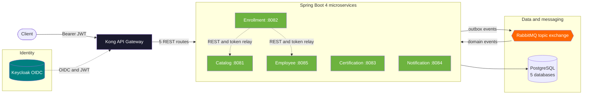

> **Design rule:** each service is the exclusive owner of its schema. No service reads another service's database; when it needs data it either calls the owning service over REST (synchronous) or waits for an event (asynchronous).

### Microservice Internal Architecture

Each microservice follows a **Layered Architecture (MVC + Domain-Driven Persistence)** optimized for Spring Boot:

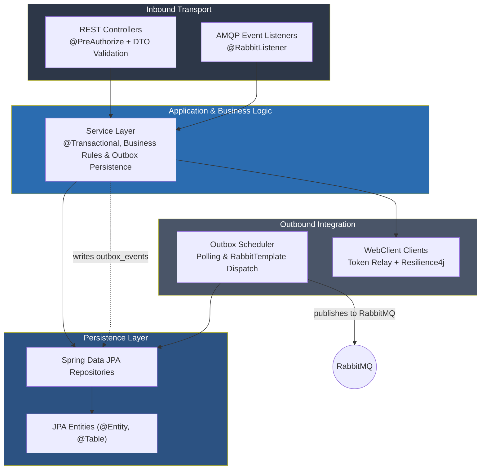

1. **Inbound Transport (`controller`, `listener`)**: REST controllers validate inputs and check role permissions. AMQP listeners handle incoming domain events with duplicate detection.
2. **Business Services (`service`)**: Encapsulate transactional workflows, business invariants, and transactional outbox event creation.
3. **Persistence (`repository`, `model`)**: Spring Data JPA interfaces backing relational entities, schema-migrated via Flyway.
4. **Outbound Clients & Schedulers (`client`, `scheduler`)**: Outbox background workers dispatch events asynchronously, while reactive `WebClient` instances call downstream endpoints with circuit breaking.

---

## ✨ Microservices Breakdown

| Service | Port | Primary Responsibilities | Event Producer | Event Consumer | Database |
|---|:---:|---|---|---|---|
| **Training Catalog** | `8081` | Course catalog, capacity limits, atomic seat allocation, course lifecycle | — | `enrollment.approved`<br/>`enrollment.cancelled`<br/>`enrollment.rejected` | `training_catalog` |
| **Enrollment** | `8082` | Enrollment lifecycle (pending, approved, rejected, completed, cancelled), seat coordination | `enrollment.created`<br/>`enrollment.approved`<br/>`enrollment.rejected`<br/>`enrollment.cancelled`<br/>`course.completed` | — | `training_enrollment` |
| **Certification** | `8083` | Automatic certificate issuance on course completion, sequential certificate numbering | `certificate.generated` | `course.completed` | `training_certification` |
| **Notification** | `8084` | User notification delivery and audit history via simulated or email senders | — | All business events | `training_notification` |
| **Employee** | `8085` | Employee registry, department records, deactivation validation | `employee.created`<br/>`employee.updated`<br/>`employee.deactivated` | — | `training_employee` |

---

## 🔄 Business Events & Choreography

### Event Catalog

| Event Name | Routing Key | Produced By | Consumed By | Action Taken |
|---|---|---|---|---|
| `EnrollmentCreatedEvent` | `enrollment.created` | Enrollment Service | Notification Service | Sends acknowledgment notification to employee |
| `EnrollmentApprovedEvent` | `enrollment.approved` | Enrollment Service | Training Catalog, Notification | Catalog confirms seat; Notification alerts employee |
| `EnrollmentRejectedEvent` | `enrollment.rejected` | Enrollment Service | Training Catalog, Notification | Catalog releases seat; Notification alerts employee |
| `EnrollmentCancelledEvent` | `enrollment.cancelled` | Enrollment Service | Training Catalog, Notification | Catalog releases reserved seat; Notification alerts employee |
| `CourseCompletedEvent` | `course.completed` | Enrollment Service | Certification, Notification | Certification issues certificate; Notification alerts employee |
| `CertificateGeneratedEvent` | `certificate.generated` | Certification Service | Notification Service | Sends congratulatory notification with certificate number |
| `EmployeeCreatedEvent` | `employee.created` | Employee Service | Notification Service | Sends welcome notification to newly onboarded employee |
| `EmployeeUpdatedEvent` | `employee.updated` | Employee Service | Notification Service | Alerts employee of profile changes |
| `EmployeeDeactivatedEvent` | `employee.deactivated` | Employee Service | Notification Service | Logs deactivation audit event |

### Complete Enrollment Lifecycle Sequence

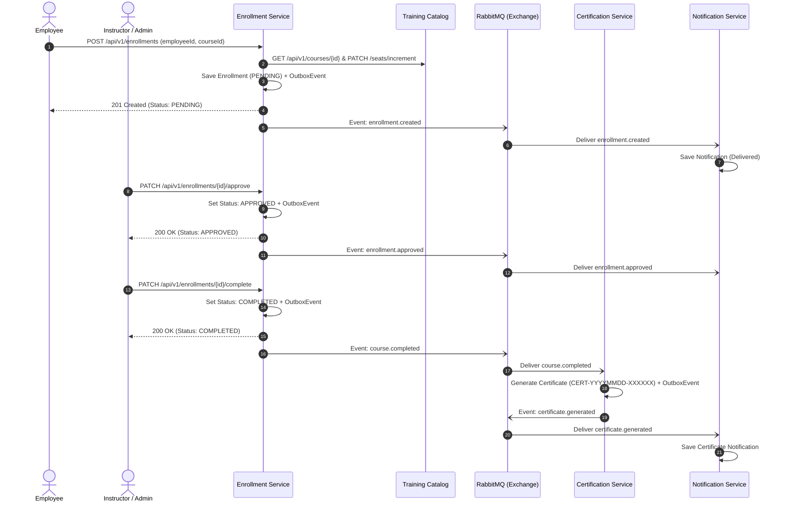

---

## 🛡️ Core Reliability Patterns

### 1. Transactional Outbox Pattern

To eliminate distributed 2-Phase Commit (2PC) transactions, events are persisted into a local `outbox_events` table inside the exact same database transaction as the domain aggregate:

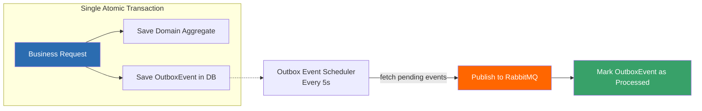

### 2. Resilience4j Circuit Breaker & Retry

Synchronous inter-service calls made by `EnrollmentService` (via `TrainingCatalogClient` and `EmployeeClient`) are protected by Resilience4j:

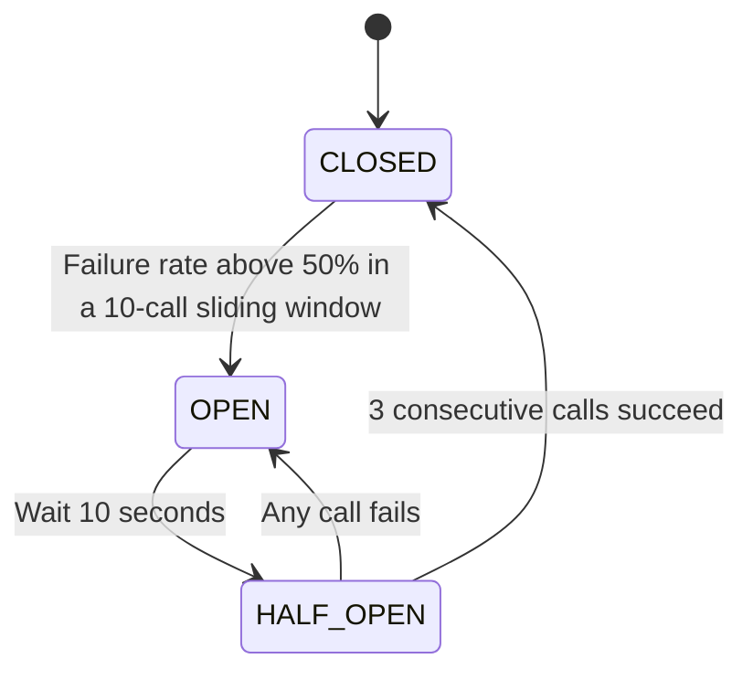

- **Retry Policy**: Maximum 3 attempts with 500ms backoff before opening the circuit.
- **Fallback Handling**: Gracefully converts downstream outages into HTTP 503 `ServiceUnavailableException`.

### 3. Consumer Idempotency

All consumers implement idempotent message handling via a dedicated `processed_events` table:
1. Verify if `eventId` exists in `ProcessedEventRepository`. If found, acknowledge and ignore.
2. Execute business logic.
3. Insert `eventId` record. Concurrent duplicate deliveries are safely caught via database unique constraint (`DataIntegrityViolationException`).

### 4. Concurrency & Seat Allocation

- **Pessimistic Locking**: `EnrollmentService` prevents double-enrollment by locking existing student records with `LockModeType.PESSIMISTIC_WRITE`.
- **Atomic SQL Updates**: `TrainingCatalogService` increments course seats atomically at database level to prevent overselling under high concurrency:
  ```sql
  UPDATE Course c SET c.enrolledCount = c.enrolledCount + 1
  WHERE c.id = :courseId AND c.enrolledCount < c.capacity
  ```

---

## 📡 API Reference

All external requests pass through Kong Gateway on `http://localhost:8000` with a valid Keycloak Bearer JWT token.

Each service publishes its own **OpenAPI 3 contract** at runtime and ships **Swagger UI** for interactive exploration. The contract is generated from the controllers and DTOs, so it cannot drift from the implementation.

| Service | Port | Swagger UI | OpenAPI JSON |
|---|:---:|---|---|
| **Training Catalog** | `8081` | `http://localhost:8081/swagger-ui/index.html` | `http://localhost:8081/v3/api-docs` |
| **Enrollment** | `8082` | `http://localhost:8082/swagger-ui/index.html` | `http://localhost:8082/v3/api-docs` |
| **Certification** | `8083` | `http://localhost:8083/swagger-ui/index.html` | `http://localhost:8083/v3/api-docs` |
| **Notification** | `8084` | `http://localhost:8084/swagger-ui/index.html` | `http://localhost:8084/v3/api-docs` |
| **Employee** | `8085` | `http://localhost:8085/swagger-ui/index.html` | `http://localhost:8085/v3/api-docs` |

Swagger UI and `/v3/api-docs` are public inside each pod so the contract can be reviewed without a token. The **Authorize** button accepts a Keycloak JWT and applies it to the operations, which remain protected by the service's resource-server security chain.

In Kubernetes, expose the UI with a port-forward and open the service directly (bypassing Kong):

```bash
kubectl port-forward svc/training-catalog-service 8081:8081 -n training-platform
# http://localhost:8081/swagger-ui/index.html
```

The OpenAPI document declares the `bearerAuth` HTTP/JWT security scheme globally, so generated clients and Postman imports get authentication wiring for free.

> **Data ownership:** users with only the `employee` role can access or modify exclusively their own records, matching the Keycloak `employeeId` claim.

---

## 🔒 Security & RBAC

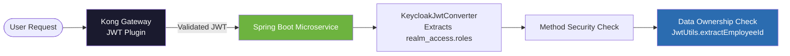

> **Kong and Keycloak complement each other, they do not overlap:** Kong rejects garbage at the edge (signature and expiry); the service re-validates the token and then decides *what* that user may do and *on which data*.

- **Authentication**: Keycloak issues RSA-signed OIDC JSON Web Tokens (JWT).
- **Token Relay**: When `EnrollmentService` makes outbound HTTP requests to downstream services, the incoming `Authorization` Bearer token is automatically propagated via a custom Netty `WebClient` exchange filter (`tokenRelayFilter`). The user's token travels with the request across the whole chain; there is no token to relay from non-HTTP threads such as AMQP listeners.
- **Role Hierarchy**:
  - `admin`: Unrestricted administrative access across all endpoints.
  - `instructor`: Manage course catalog, review enrollments, grade completions.
  - `employee`: View catalog, request enrollment, cancel own enrollments, view personal certificates and notifications.

---

## ☸️ Infrastructure & Deployment

### Local Docker Compose Stack (9 Containers)

```bash
rake infra:start
```

| Container | Image | Port | Description |
|---|---|:---:|---|
| `postgres` | `postgres:16-alpine` | `5432` | Multi-database relational storage |
| `keycloak` | `quay.io/keycloak/keycloak:26.0` | `8080` | OIDC Identity Provider |
| `rabbitmq` | `rabbitmq:3.13-management-alpine` | `5672`, `15672` | AMQP Message Broker & Web Management |
| `kong` | `kong:3.6` | `8000`, `8001` | API Gateway & Admin API |
| `prometheus` | `prom/prometheus:v2.50.0` | `9090` | Metrics scraper from `/actuator/prometheus` |
| `grafana` | `grafana/grafana:10.3.1` | `3000` | Pre-provisioned dashboards |
| `jaeger` | `jaegertracing/all-in-one:1.54` | `16686` | Distributed trace visualizer |
| `loki` | `grafana/loki:2.9.4` | `3100` | Centralized log aggregator |
| `otel-collector` | `otel/opentelemetry-collector-contrib:0.94.0` | `4317`, `4318` | OpenTelemetry gRPC / HTTP pipeline |

### Kubernetes Deployment (kind + Podman)

The `infra/k8s` directory provides complete declarative Kubernetes specifications for the `training-platform` namespace:
- **Deployments & StatefulSets**: Dedicated pods for each microservice with resource requests/limits and persistent storage for PostgreSQL.
- **Horizontal Pod Autoscaling (HPA)**: HPA manifests for every service; `metrics-server` is installed by `rake k8s:metrics` and validated through `kubectl top` and live CPU utilization. Scale-up uses a 900-second stabilization window so JVM startup bursts on the single-node kind cluster do not create unschedulable replicas.
- **Health Probes**: Startup, liveness, and readiness probes against Spring Boot Actuator (`/actuator/health/liveness` and `/actuator/health/readiness`).
- **NetworkPolicies**: Default-deny with explicit service-to-service, Kong, Keycloak, RabbitMQ, PostgreSQL, Prometheus, and OTel Collector rules.
- **ConfigMaps & Secrets**: Externalized connection strings, broker topology, realm import, and a deterministic RSA key for Kong JWT validation.
- **Observability**: All five services export OTLP traces and logs to the OpenTelemetry Collector; Jaeger stores traces, Loki stores logs labelled by `service_name`, Prometheus scrapes JVM/HTTP metrics, and Grafana provisions all three datasources.
- **API Contracts**: springdoc generates an OpenAPI 3 document and Swagger UI for every service, with a global `bearerAuth` scheme.

Logs are exported directly from Logback, without sidecars: each service registers `OpenTelemetryAppender` and installs the SDK instance created by Spring Boot 4. Records go over OTLP/HTTP to `http://otel-collector:4318/v1/logs`; the collector's `resource/loki` processor promotes `service.name` to the `service_name` Loki label before pushing to `http://loki:3100/loki/api/v1/push`. Traces use the same path to `http://otel-collector:4318/v1/traces` and are forwarded to Jaeger over OTLP/gRPC.

OTel resource names follow each service's `spring.application.name`: `training-catalog-service`, `enrollment-service`, `certification-service`, `notification-service`, and `employee-service`. Kubernetes deployment names keep the `training-` prefix, so the QA harness maps deployment names to their OTel service names when querying Jaeger and Loki.

### Kubernetes Validation Evidence

Validated on **2026-10-31** against the kind cluster `poc-qa` (Kubernetes `v1.36.1`, Podman rootful), namespace `training-platform`.

| Validation | Observed result |
|---|---|
| Workloads | **14/14 pods Running and Ready** |
| Container restarts | **0** |
| CrashLoopBackOff / Error pods | none |
| Smoke suite (`rake k8s:smoke`) | **PASS** |
| Full E2E flow (`rake k8s:test`) | **PASS** (`course=3`, `employee=2`) |
| Kong entry point | `401` without JWT, `200` with JWT |
| Certificate issued | `CERT-20261031-000002` |
| Notifications | `ENROLLMENT_CREATED`, `ENROLLMENT_APPROVED`, `COURSE_COMPLETED`, `CERTIFICATE_GENERATED` all `DELIVERED` |
| Outbox and RabbitMQ | fully processed, `0` dead-letter messages |
| Prometheus targets | all `UP` |
| Horizontal Pod Autoscalers | 5 HPAs with live CPU metrics (`4%`–`46%` of a `70%` target), 1 replica each |
| Jaeger | traces received from all five services, including `enrollment-service` |
| Loki | logs received from all five services, including `enrollment-service` |

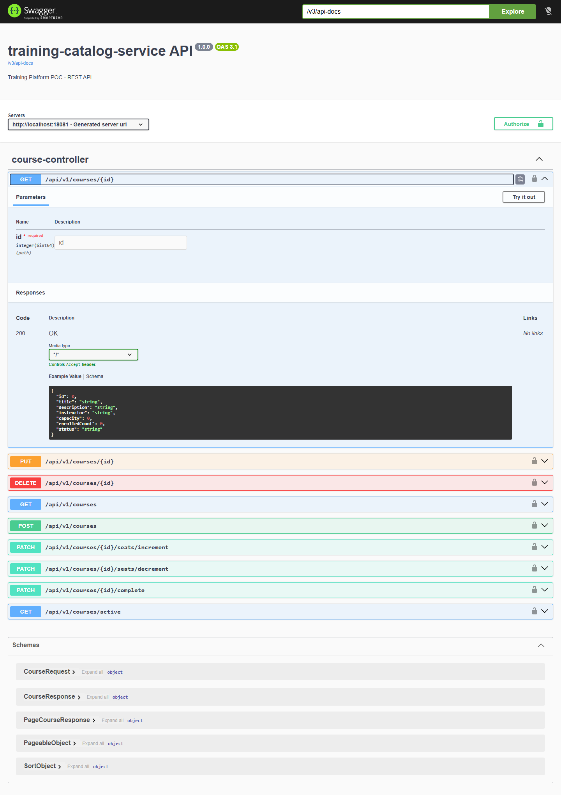

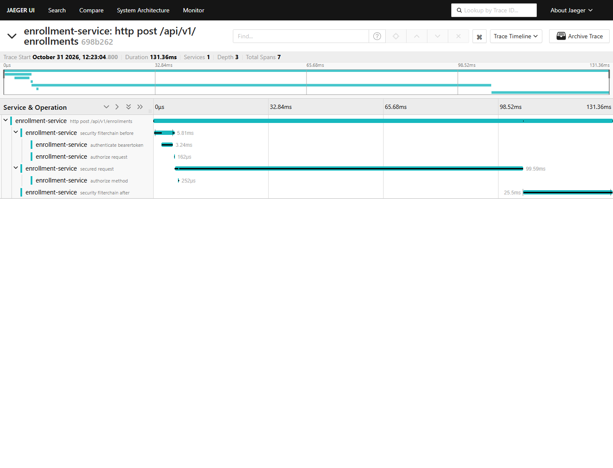

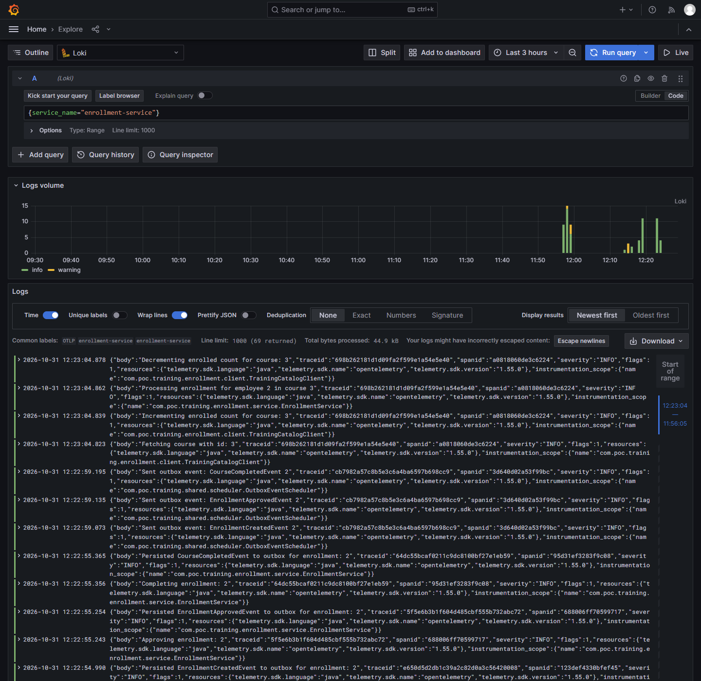

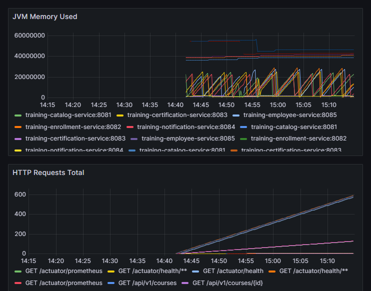

<details>
<summary>Captured <code>kubectl get pods -n training-platform</code> output</summary>

```text
NAME                                              READY   STATUS    RESTARTS   AGE
postgresql-0                                      1/1     Running   0          38m
training-catalog-service-6c48fd66c6-96g7c         1/1     Running   0          34m
training-certification-service-5bfd4d5bf9-62wrd   1/1     Running   0          29m
training-employee-service-57b4fcc6c5-9g24f        1/1     Running   0          25m
training-enrollment-service-fc88b7ff5-n26fn       1/1     Running   0          32m
training-grafana-68f67d7644-jgxbh                 1/1     Running   0          36m
training-jaeger-67568dd94-xrbmg                   1/1     Running   0          36m
training-keycloak-679c7bd954-dpgl7                1/1     Running   0          38m
training-kong-b77fc4f7f-4tzwx                     1/1     Running   0          35m
training-loki-78fd47d8dc-lpsqw                    1/1     Running   0          36m
training-notification-service-5d9b7b458-d25fb     1/1     Running   0          27m
training-otel-collector-598894cf88-d89fp          1/1     Running   0          36m
training-prometheus-6cdb5df79-wj64g               1/1     Running   0          36m
training-rabbitmq-5899dd7869-v8lrx                1/1     Running   0          38m
```

</details>

<details>
<summary>Captured <code>kubectl get hpa -n training-platform</code> output</summary>

```text
NAME                                 REFERENCE                                   TARGETS        MINPODS   MAXPODS   REPLICAS   AGE
training-catalog-service-hpa         Deployment/training-catalog-service         cpu: 46%/70%   1         10        1          19m
training-certification-service-hpa   Deployment/training-certification-service   cpu: 6%/70%    1         10        1          19m
training-employee-service-hpa        Deployment/training-employee-service        cpu: 37%/70%   1         10        1          19m
training-enrollment-service-hpa      Deployment/training-enrollment-service      cpu: 4%/70%    1         10        1          19m
training-notification-service-hpa    Deployment/training-notification-service   cpu: 7%/70%    1         10        1          19m
```

</details>

The checks are implemented in [`qa/smoke.rb`](qa/smoke.rb) and [`qa/run_all.rb`](qa/run_all.rb). Reproduce them with:

```powershell
$env:CONTAINER_CONNECTION='podman-machine-default-root'
rake k8s:smoke
rake k8s:test
```

---

## 🧪 Testing & Quality

### Test Pyramid

The suite is organized in three layers, from fast isolated checks to the full platform flow:

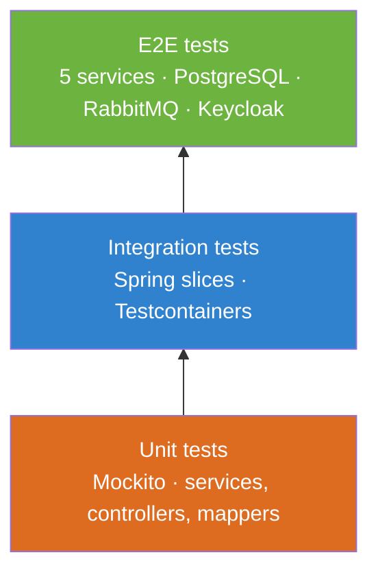

Unit tests form the broad base; integration tests exercise persistence and messaging with real containers; the Gradle E2E layer validates the complete business flow against the five services directly, while `rake k8s:smoke` and `rake k8s:test` exercise the same flow **through Kong** in the kind cluster.

### Test Coverage & Quality Gates

Enforced in `build.gradle.kts` via `JacocoCoverageVerification` requiring **100% instruction, branch, line, and method coverage**. The `check` task depends on the verification task, so a regression fails the build:

```
╔══════════════════════════════════════════════════════════════════════════════╗
║                          JACOCO COVERAGE REPORT                             ║
╠══════════════════════════════════════════════════════════════════════════════╣
  Module                        Instruction      Branch        Line      Method
  ──────────────────────────────────────────────────────────────────────────
  training-catalog-service      100.0%           100.0%        100.0%    100.0%
  employee-service              100.0%           100.0%        100.0%    100.0%
  enrollment-service            100.0%           100.0%        100.0%    100.0%
  certification-service         100.0%           100.0%        100.0%    100.0%
  notification-service          100.0%           100.0%        100.0%    100.0%
  shared                        100.0%           100.0%        100.0%    100.0%
  ──────────────────────────────────────────────────────────────────────────
  TOTAL                         100.0%           100.0%        100.0%    100.0%
╚══════════════════════════════════════════════════════════════════════════════╝
```

---

## 🏁 Quick Start

### Prerequisites
- **Java 21 LTS**
- **Docker Desktop** or **Podman** (with Docker socket enabled)
- **Ruby** (optional, for `rake` automation tasks)

### Step 1: Start Infrastructure
```bash
rake infra:start
# or manually via Docker Compose:
docker compose -f infra/docker-compose.yml up -d
```

### Step 2: Run Unit + Integration Tests and the Coverage Gate
```bash
# Fast feedback: skips the slow E2E module
./gradlew test -x :e2e-tests:test jacocoTestReport jacocoTestCoverageVerification
```
`test` is a lifecycle task, so by default it also runs `:e2e-tests:test`. The `-x` above keeps this step focused on unit and integration layers; `rake test:run` deliberately runs everything.

### Step 3: Run Full End-to-End Suite
```bash
./gradlew e2eTest
```
`e2eTest` is an alias for `:e2e-tests:test`; it starts PostgreSQL, RabbitMQ, Keycloak, and all five services with Testcontainers. The current suite runs **64 tests across 8 classes** (course management, enrollment flow, async events, outbox, resilience, security, and edge cases) with 0 failures in ~15 minutes on the reference machine.

### Step 4: Deploy to Local Kubernetes (kind + Podman)

Prerequisites: `kind`, `kubectl`, and a Podman machine. The QA tasks use the rootful Podman connection `podman-machine-default-root`.

```powershell
$env:CONTAINER_CONNECTION='podman-machine-default-root'
rake k8s:cluster:create   # create the kind cluster 'poc-qa'
rake k8s:build            # build the five Spring Boot images
rake k8s:load             # load app + infra images into the kind node
rake k8s:deploy           # namespace, data stores, Keycloak, services, observability, Kong
rake k8s:wait             # wait for every rollout
rake k8s:smoke            # readiness, OIDC, Kong, databases, queues, Prometheus
rake k8s:test             # full E2E business flow through Kong
```

`rake k8s:up` chains build, load, deploy, wait, and smoke on an existing cluster.

Local endpoints:
- **Kong proxy:** http://localhost:8000 (NodePort `30080`)
- **Kong admin:** http://localhost:8001 (NodePort `30081`)
- **Keycloak:** `kubectl port-forward svc/keycloak 18080:8080 -n training-platform`
- **Prometheus:** `kubectl port-forward svc/prometheus 19090:9090 -n training-platform`
- **Grafana:** `kubectl port-forward svc/grafana 13000:3000 -n training-platform` (`admin` / `admin`)
- **Jaeger:** `kubectl port-forward svc/jaeger 16686:16686 -n training-platform`
- **Loki API:** `kubectl port-forward svc/loki 13100:3100 -n training-platform`
- **Swagger UI:** `kubectl port-forward svc/training-catalog-service 8081:8081 -n training-platform`

### Pre-configured Test Users

| Username | Password | Role | Employee ID Claim |
|---|---|---|:---:|
| `admin` | `admin` | `admin` | `1` |
| `instructor1` | `instructor1` | `instructor` | `2` |
| `employee1` | `employee1` | `employee` | `3` |

---

## 📁 Project Structure

```
poc_architecture/
├── services/
│   ├── training-catalog-service/   # Course catalog, capacity & seat management (:8081)
│   ├── enrollment-service/         # Enrollment orchestration & lifecycle (:8082)
│   ├── certification-service/      # Automated certificate generation (:8083)
│   ├── notification-service/       # Multi-channel notification dispatch (:8084)
│   └── employee-service/           # Employee registry & profile management (:8085)
├── shared/                         # Outbox scheduler, common events, JWT utilities
├── e2e-tests/                      # Full stack Testcontainers end-to-end test suite
├── test-support/                   # Test fixtures, mock servers, and testing helpers
├── infra/
│   ├── docker-compose.yml          # Local stack (Postgres, RabbitMQ, Keycloak, Kong, OTel, Jaeger, Loki)
│   ├── k8s/                        # Kubernetes manifests (services, HPA, metrics-server, observability)
│   ├── kind/                       # kind cluster configuration for local QA
│   ├── keycloak/ kong/ otel/ ...   # Component configuration for Compose
│   └── prometheus/ grafana/        # Local observability provisioning
├── build.gradle.kts                # Multi-project Gradle build configuration & JaCoCo gates
├── Rakefile                        # Automation tasks (infra:start, test:run, k8s:deploy)
└── README.md                       # Architectural documentation
```

---

## 📄 License

This is a Proof of Concept. Not intended for production use.

This project is licensed under the MIT License, an open-source software license that allows developers to freely use, copy, modify, and distribute the software. This includes use in both personal and commercial projects, with the only requirement being that the original copyright notice is retained.

```
MIT License

Copyright (c) 2026 Sergio Sanchez

Permission is hereby granted, free of charge, to any person obtaining a copy
of this software and associated documentation files (the "Software"), to deal
in the Software without restriction, including without limitation the rights
to use, copy, modify, merge, publish, distribute, sublicense, and/or sell
copies of the Software, and to permit persons to whom the Software is
furnished to do so, subject to the following conditions:

The above copyright notice and this permission notice shall be included in all
copies or substantial portions of the Software.

THE SOFTWARE IS PROVIDED "AS IS", WITHOUT WARRANTY OF ANY KIND, EXPRESS OR
IMPLIED, INCLUDING BUT NOT LIMITED TO THE WARRANTIES OF MERCHANTABILITY,
FITNESS FOR A PARTICULAR PURPOSE AND NONINFRINGEMENT. IN NO EVENT SHALL THE
AUTHORS OR COPYRIGHT HOLDERS BE LIABLE FOR ANY CLAIM, DAMAGES OR OTHER
LIABILITY, WHETHER IN AN ACTION OF CONTRACT, TORT OR OTHERWISE, ARISING FROM,
OUT OF OR IN CONNECTION WITH THE SOFTWARE OR THE USE OR OTHER DEALINGS IN THE
SOFTWARE.
```
