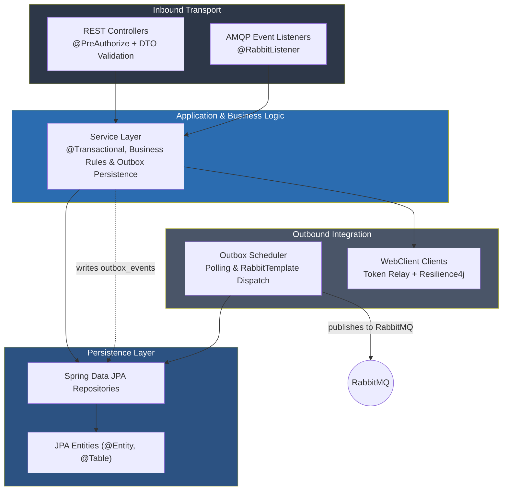
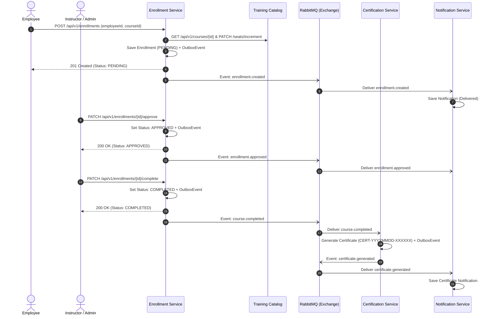
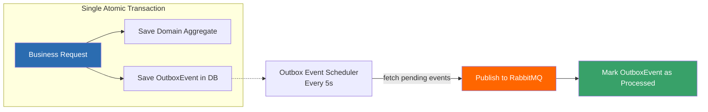
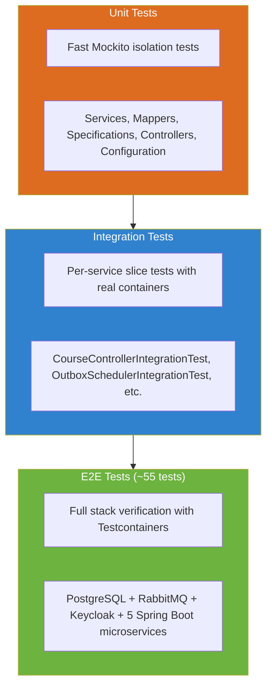

<div align="center">

# Training Platform — Cloud-Native Microservices Architecture

[](https://openjdk.org/projects/jdk/21/)
[](https://spring.io/projects/spring-boot)
[](https://www.rabbitmq.com/)
[](https://www.postgresql.org/)
[](https://www.keycloak.org/)
[](https://konghq.com/)
[](https://kubernetes.io/)
[](#-test-coverage--quality-gates)
[](LICENSE)

A production-grade Proof-of-Concept demonstrating an **Event-Driven Microservices Architecture** for enterprise training management. Built with Spring Boot 4, Database-per-Service, Transactional Outbox, Kong Gateway, Keycloak OAuth2/OIDC, Resilience4j, and OpenTelemetry observability — validated by a full end-to-end test suite and 100% test coverage.

---

[📋 Disclaimer](#-disclaimer) · [🚀 Why This Stack?](#-why-this-stack) · [💪 Strengths & Trade-offs](#-strengths-and-trade-offs) · [🏗️ Architecture](#%EF%B8%8F-architecture) · [✨ Microservices Breakdown](#-microservices-breakdown) · [🔄 Business Events & Flow](#-business-events--choreography) · [🛡️ Core Reliability Patterns](#%EF%B8%8F-core-reliability-patterns) · [📡 API Reference](#-api-reference) · [🔒 Security & RBAC](#-security--rbac) · [☸️ Infrastructure & Kubernetes](#%EF%B8%8F-infrastructure--deployment) · [🧪 Testing & Quality](#-testing--quality) · [🏁 Quick Start](#-quick-start) · [📁 Project Structure](#-project-structure)

</div>

---

## 📋 Disclaimer

This repository is developed as an **architectural proof-of-concept (POC)** for research, benchmarking, and architectural evaluation. Its purpose is to demonstrate enterprise-grade distributed system patterns:
- **Event-Driven Choreography** over RabbitMQ topic exchanges.
- **Transactional Outbox Pattern** guaranteeing reliable event publishing without distributed 2PC transactions.
- **Database-per-Service** isolation with schema migrations managed independently via Flyway.
- **Distributed Security & Token Relay** via Kong Gateway, Keycloak, and WebClient filter propagation.
- **Resilience Engineering** using Resilience4j Circuit Breakers, Retries, and Fallbacks.

While this POC achieves **100% JaCoCo test coverage** and runs realistic multi-container integration and E2E suites via Testcontainers, transitioning to full production would require addressing production-hardening aspects outlined in [Strengths & Trade-offs](#-strengths-and-trade-offs).

---

## 🚀 Why This Stack?

### ☕ Why Java 21?

Java 21 LTS brings modern language features and runtime enhancements tailored for high-throughput cloud environments:

| Feature | Usage in this POC | Architectural Benefit |
|---|---|---|
| **Records** | DTOs and immutable event payloads (`CourseDTO`, `EmployeeDTO`, `BaseEvent` subclasses) | Eliminates boilerplate; ensures immutable event contracts across microservices |
| **Pattern Matching & Switch** | Error handling and exception conversion in `GlobalExceptionHandler` | Concise, type-safe condition branching without manual casting |
| **Sequenced Collections** | Ordered event queries and history pagination | Predictable ordering guarantees for event sourcing and outbox queues |
| **Virtual Threads (Project Loom ready)** | Non-blocking concurrency profile ready for high-load I/O dispatching | Drastically decreases thread-stack overhead when orchestrating asynchronous workloads |

---

### 🍃 Why Spring Boot 4?

Spring Boot remains the enterprise gold standard for distributed Java microservices:

- **Ecosystem Maturity**: Native, battle-tested integration with Spring Data JPA, Spring Security OAuth2 Resource Server, Spring AMQP, and Spring Cloud starters.
- **Declarative Transactions**: Fine-grained ACID boundaries via `@Transactional` essential for the local Transactional Outbox pattern.
- **Reactive Client (`WebClient`)**: Allows synchronous inter-service communication with thread-efficient execution and non-blocking timeout controls.
- **Observability Integration**: Out-of-the-box Micrometer metrics exportable directly to Prometheus, and tracing hooks compatible with OpenTelemetry (OTel).
- **Testcontainers Support**: First-class container integration that enables spinning up disposable PostgreSQL, RabbitMQ, and Keycloak instances for realistic automated verification.

---

### 🐰 Why RabbitMQ & AMQP?

RabbitMQ was selected as the asynchronous messaging broker over Kafka for this specific domain:

- **Topic Exchange Routing**: Powerful routing key wildcards (`enrollment.*`, `course.*`, `employee.*`) allowing services to bind only to relevant domain events without managing custom consumer group partition offsets.
- **Lightweight Broker Model**: Operates with low memory footprint and instantaneous startup in CI/CD and local development compared to multi-node Kafka clusters.
- **Dead Letter Exchanges (DLX)**: Native routing of unprocessable messages to dead-letter queues (`catalog.dlq`, `certification.dlq`, `notification.dlq`) with automated retry headers.
- **At-Least-Once Delivery**: Works in tandem with local outbox tables and idempotent consumer tables (`processed_events`).

---

### 🐘 Why PostgreSQL & Database-per-Service?

- **Relational Integrity**: The training domain exhibits strong relational constraints (courses, capacity limits, enrollments, certificates, employees).
- **ACID Guarantees for Outbox**: Writing the domain state change and the outbound event record into the **same relational database transaction** guarantees zero ghost events and zero missed messages.
- **Independent Schema Versioning**: Each microservice connects exclusively to its own database (`training_catalog`, `training_enrollment`, `training_certification`, `training_notification`, `training_employee`) managed via independent Flyway migrations.

---

### 🦍 Why Kong Gateway & Keycloak?

- **Kong API Gateway (Port 8000)**: Serves as the single entry point for external traffic. Provides centralized rate limiting (100 req/min), CORS policy enforcement, route aggregation, and preliminary JWT token validation.
- **Keycloak Identity Provider (Port 8080)**: Centralized OAuth2/OIDC identity management with role-based access control (RBAC). Injects a custom `employeeId` claim into JWT tokens to enable fine-grained data ownership verification across services.

---

### 🤔 Why Not Alternatives?

| Stack / Technology | Evaluation against this POC | Why Spring Boot + RabbitMQ was selected |
|---|---|---|
| **Quarkus + Camel** | Excellent container footprint and build-time optimization | Spring Boot provides broader enterprise developer familiarity, richer Spring Data JPA integration, and mature OAuth2 Resource Server tooling |
| **Micronaut** | Low memory and compile-time DI | Smaller ecosystem for complex AMQP topologies and fewer community recipes for Kong + Keycloak token relay |
| **Apache Kafka** | Excels at high-volume stream ingestion and log replay | Overkill for transactional business workflows with moderate event volume; RabbitMQ topic exchanges provide simpler routing semantics and built-in DLQ |
| **Go / Gin** | Ultra-fast execution and tiny memory footprint | Lacks the rich ORM and enterprise ecosystem (Spring Data, Flyway, declarative security) needed for rapid relational domain modeling |

---

## 💪 Strengths and Trade-offs

### Strengths

| Dimension | POC Demonstration |
|---|---|
| **Reliable Asynchronous Events** | Transactional Outbox pattern implemented across 4 producing services to prevent 2PC distributed transactions |
| **Strict Service Independence** | True Database-per-Service pattern: 5 isolated PostgreSQL databases with independent Flyway migrations |
| **Downstream Fault Tolerance** | Resilience4j Circuit Breakers, Retries, and Fallbacks wrap inter-service HTTP calls (`Enrollment -> Catalog`, `Enrollment -> Employee`) |
| **Distributed Security & Token Relay** | Keycloak JWT propagation through Kong Gateway and downstream HTTP calls via `WebClient` authorization filters |
| **Idempotent Consumers** | `ProcessedEvent` tracking table prevents duplicate event execution on at-least-once message delivery |
| **100% JaCoCo Coverage** | Strict build gate enforcing 100% instruction, branch, line, and method coverage across all 6 Gradle modules |
| **Real Infrastructure E2E** | Comprehensive E2E test suite running all 5 microservices alongside PostgreSQL, RabbitMQ, and Keycloak containers |
| **Cloud-Native Topology** | Kubernetes manifests with HPA (Horizontal Pod Autoscalers), ConfigMaps, Secrets, and Liveness/Readiness probes |

### Trade-offs & Production Considerations

| Area | Current POC Implementation | Production Requirement |
|---|---|---|
| **Internal Architecture** | **Layered (3-Tier) Architecture**: Clean separation (`controller`, `service`, `repository`, `model`), directly leveraging Spring Data JPA entities in services | For high domain complexity, evolve to Hexagonal (Ports & Adapters) with pure domain entities isolated from Jakarta/Hibernate annotations |
| **Outbox Polling Concurrency** | Scheduled polling query fetches pending outbox events every 5 seconds using pessimistic locking released at query commit | Use `FOR UPDATE SKIP LOCKED` or a distributed coordinator (e.g. ShedLock or Debezium CDC) when running multiple pod replicas |
| **Outbox Poison Pill Handling** | Events exceeding max retries (`MAX_RETRIES = 5`) remain flagged as `processed = false` | Introduce a dedicated `FAILED` terminal status to prevent failed events from dominating the polling batch |
| **Network I/O in Transactions** | `EnrollmentService.enroll()` performs synchronous HTTP calls to verify capacity before persisting the local entity | Fully transition enrollment seat reservations to an asynchronous event saga or decouple HTTP calls from the `@Transactional` boundary |
| **Notification Provider** | Uses `SimulatedNotificationSender` by default (logs notifications), with an optional Spring profile for JavaMailSender | Connect to real transactional email/SMS gateways (SendGrid, AWS SES, Twilio) with template rendering engines |

---

## 🏗️ Architecture

### System Topology

```mermaid
flowchart TD
    Client([Web / Mobile Client]) -->|HTTPS / Bearer JWT| Kong["Kong API Gateway<br/>:8000<br/>JWT Validation + Rate Limiting"]

    subgraph Identity ["Identity & Access"]
        Keycloak["Keycloak OIDC<br/>:8080<br/>training-realm"]
    end

    Client -.->|Authenticate| Keycloak

    subgraph Services ["Microservices Layer (Spring Boot 4)"]
        Catalog["Training Catalog Service<br/>:8081"]
        Enrollment["Enrollment Service<br/>:8082"]
        Certification["Certification Service<br/>:8083"]
        Notification["Notification Service<br/>:8084"]
        Employee["Employee Service<br/>:8085"]
    end

    Kong -->|/api/v1/courses| Catalog
    Kong -->|/api/v1/enrollments| Enrollment
    Kong -->|/api/v1/certificates| Certification
    Kong -->|/api/v1/notifications| Notification
    Kong -->|/api/v1/employees| Employee

    Enrollment -->|HTTP + Token Relay<br/>(Resilience4j)| Catalog
    Enrollment -->|HTTP + Token Relay<br/>(Resilience4j)| Employee

    subgraph Messaging ["Message Broker"]
        RabbitMQ(("RabbitMQ<br/>training.exchange (topic)"))
    end

    Enrollment -->|outbox relay| RabbitMQ
    Certification -->|outbox relay| RabbitMQ
    Employee -->|outbox relay| RabbitMQ

    RabbitMQ -->|enrollment.approved<br/>enrollment.cancelled| Catalog
    RabbitMQ -->|course.completed| Certification
    RabbitMQ -->|enrollment.*<br/>course.completed<br/>certificate.generated<br/>employee.*| Notification

    subgraph Storage ["Database-per-Service (PostgreSQL)"]
        DB1[(training_catalog)]
        DB2[(training_enrollment)]
        DB3[(training_certification)]
        DB4[(training_notification)]
        DB5[(training_employee)]
    end

    Catalog --> DB1
    Enrollment --> DB2
    Certification --> DB3
    Notification --> DB4
    Employee --> DB5

    style Kong fill:#1a1a2e,color:#fff
    style Keycloak fill:#008080,color:#fff
    style RabbitMQ fill:#ff6600,color:#fff
    style Catalog fill:#6DB33F,color:#fff
    style Enrollment fill:#6DB33F,color:#fff
    style Certification fill:#6DB33F,color:#fff
    style Notification fill:#6DB33F,color:#fff
    style Employee fill:#6DB33F,color:#fff
```

### Microservice Internal Architecture

Each microservice follows a **Layered Architecture (MVC + Domain-Driven Persistence)** optimized for Spring Boot:



1. **Inbound Transport (`controller`, `listener`)**: REST controllers validate inputs and check role permissions. AMQP listeners handle incoming domain events with duplicate detection.
2. **Business Services (`service`)**: Encapsulate transactional workflows, business invariants, and transactional outbox event creation.
3. **Persistence (`repository`, `model`)**: Spring Data JPA interfaces backing relational entities, schema-migrated via Flyway.
4. **Outbound Clients & Schedulers (`client`, `scheduler`)**: Outbox background workers dispatch events asynchronously, while reactive `WebClient` instances call downstream endpoints with circuit breaking.

---

## ✨ Microservices Breakdown

| Service | Port | Primary Responsibilities | Event Producer | Event Consumer | Database |
|---|:---:|---|---|---|---|
| **Training Catalog** | `8081` | Course catalog, capacity limits, atomic seat allocation, course lifecycle | — | `enrollment.approved`<br/>`enrollment.cancelled`<br/>`enrollment.rejected` | `training_catalog` |
| **Enrollment** | `8082` | Enrollment lifecycle (pending, approved, rejected, completed, cancelled), seat coordination | `enrollment.created`<br/>`enrollment.approved`<br/>`enrollment.rejected`<br/>`enrollment.cancelled`<br/>`course.completed` | — | `training_enrollment` |
| **Certification** | `8083` | Automatic certificate issuance on course completion, sequential certificate numbering | `certificate.generated` | `course.completed` | `training_certification` |
| **Notification** | `8084` | User notification delivery and audit history via simulated or email senders | — | All business events | `training_notification` |
| **Employee** | `8085` | Employee registry, department records, deactivation validation | `employee.created`<br/>`employee.updated`<br/>`employee.deactivated` | — | `training_employee` |

---

## 🔄 Business Events & Choreography

### Event Catalog

| Event Name | Routing Key | Produced By | Consumed By | Action Taken |
|---|---|---|---|---|
| `EnrollmentCreatedEvent` | `enrollment.created` | Enrollment Service | Notification Service | Sends acknowledgment notification to employee |
| `EnrollmentApprovedEvent` | `enrollment.approved` | Enrollment Service | Training Catalog, Notification | Catalog confirms seat; Notification alerts employee |
| `EnrollmentRejectedEvent` | `enrollment.rejected` | Enrollment Service | Training Catalog, Notification | Catalog releases seat; Notification alerts employee |
| `EnrollmentCancelledEvent` | `enrollment.cancelled` | Enrollment Service | Training Catalog, Notification | Catalog releases reserved seat; Notification alerts employee |
| `CourseCompletedEvent` | `course.completed` | Enrollment Service | Certification, Notification | Certification issues certificate; Notification alerts employee |
| `CertificateGeneratedEvent` | `certificate.generated` | Certification Service | Notification Service | Sends congratulatory notification with certificate number |
| `EmployeeCreatedEvent` | `employee.created` | Employee Service | Notification Service | Sends welcome notification to newly onboarded employee |
| `EmployeeUpdatedEvent` | `employee.updated` | Employee Service | Notification Service | Alerts employee of profile changes |
| `EmployeeDeactivatedEvent` | `employee.deactivated` | Employee Service | Notification Service | Logs deactivation audit event |

### Complete Enrollment Lifecycle Sequence



---

## 🛡️ Core Reliability Patterns

### 1. Transactional Outbox Pattern

To eliminate distributed 2-Phase Commit (2PC) transactions, events are persisted into a local `outbox_events` table inside the exact same database transaction as the domain aggregate:



### 2. Resilience4j Circuit Breaker & Retry

Synchronous inter-service calls made by `EnrollmentService` (via `TrainingCatalogClient` and `EmployeeClient`) are protected by Resilience4j:


- **Retry Policy**: Maximum 3 attempts with 500ms backoff before opening the circuit.
- **Fallback Handling**: Gracefully converts downstream outages into HTTP 503 `ServiceUnavailableException`.

### 3. Consumer Idempotency

All consumers implement idempotent message handling via a dedicated `processed_events` table:
1. Verify if `eventId` exists in `ProcessedEventRepository`. If found, acknowledge and ignore.
2. Execute business logic.
3. Insert `eventId` record. Concurrent duplicate deliveries are safely caught via database unique constraint (`DataIntegrityViolationException`).

### 4. Concurrency & Seat Allocation

- **Pessimistic Locking**: `EnrollmentService` prevents double-enrollment by locking existing student records with `LockModeType.PESSIMISTIC_WRITE`.
- **Atomic SQL Updates**: `TrainingCatalogService` increments course seats atomically at database level to prevent overselling under high concurrency:
  ```sql
  UPDATE Course c SET c.enrolledCount = c.enrolledCount + 1
  WHERE c.id = :courseId AND c.enrolledCount < c.capacity
  ```

---

## 📡 API Reference

All requests pass through Kong Gateway on `http://localhost:8000` with a valid Keycloak Bearer JWT token.

### Training Catalog Service (`/api/v1/courses`)

| Method | Endpoint | Description | Allowed Roles |
|---|---|---|---|
| `GET` | `/api/v1/courses` | List courses (paginated, sorted, filterable) | `employee`, `instructor`, `admin` |
| `GET` | `/api/v1/courses/active` | List active courses | `employee`, `instructor`, `admin` |
| `GET` | `/api/v1/courses/{id}` | Get course by ID | `employee`, `instructor`, `admin` |
| `POST` | `/api/v1/courses` | Create new course | `admin` |
| `PUT` | `/api/v1/courses/{id}` | Update course details / capacity | `instructor`, `admin` |
| `DELETE` | `/api/v1/courses/{id}` | Soft-deactivate course | `admin` |
| `PATCH` | `/api/v1/courses/{id}/complete` | Mark course as completed | `instructor`, `admin` |
| `PATCH` | `/api/v1/courses/{id}/seats/increment` | Increment enrolled seats | `instructor`, `admin`, `employee` |
| `PATCH` | `/api/v1/courses/{id}/seats/decrement` | Decrement enrolled seats | `instructor`, `admin`, `employee` |

### Enrollment Service (`/api/v1/enrollments`)

| Method | Endpoint | Description | Allowed Roles |
|---|---|---|---|
| `GET` | `/api/v1/enrollments` | List enrollments (filterable by `employeeId`) | `employee`*, `instructor`, `admin` |
| `GET` | `/api/v1/enrollments/{id}` | Get enrollment by ID | `employee`*, `instructor`, `admin` |
| `GET` | `/api/v1/enrollments/active/{employeeId}` | Check active enrollments | `instructor`, `admin` |
| `POST` | `/api/v1/enrollments` | Enroll employee in a course | `employee`*, `instructor`, `admin` |
| `PATCH` | `/api/v1/enrollments/{id}/approve` | Approve pending enrollment | `instructor`, `admin` |
| `PATCH` | `/api/v1/enrollments/{id}/complete` | Mark enrollment completed (triggers certificate) | `instructor`, `admin` |
| `PATCH` | `/api/v1/enrollments/{id}/reject` | Reject pending enrollment | `instructor`, `admin` |
| `PATCH` | `/api/v1/enrollments/{id}/cancel` | Cancel enrollment | `employee`*, `instructor`, `admin` |

### Certification Service (`/api/v1/certificates`)

| Method | Endpoint | Description | Allowed Roles |
|---|---|---|---|
| `GET` | `/api/v1/certificates` | List certificates by `employeeId` | `employee`*, `instructor`, `admin` |
| `GET` | `/api/v1/certificates/{id}` | Get certificate by ID | `employee`*, `instructor`, `admin` |
| `GET` | `/api/v1/certificates/number/{number}` | Get certificate by unique number | `employee`*, `instructor`, `admin` |

### Notification Service (`/api/v1/notifications`)

| Method | Endpoint | Description | Allowed Roles |
|---|---|---|---|
| `GET` | `/api/v1/notifications` | List notifications for recipient | `employee`*, `instructor`, `admin` |
| `GET` | `/api/v1/notifications/{id}` | Get notification by ID | `employee`*, `instructor`, `admin` |

### Employee Service (`/api/v1/employees`)

| Method | Endpoint | Description | Allowed Roles |
|---|---|---|---|
| `GET` | `/api/v1/employees` | List employees (paginated, sorted) | `instructor`, `admin` |
| `GET` | `/api/v1/employees/{id}` | Get employee details | `employee`, `instructor`, `admin` |
| `GET` | `/api/v1/employees/number/{number}` | Find employee by business number | `instructor`, `admin` |
| `GET` | `/api/v1/employees/{id}/exists` | Fast existence check | `employee`, `instructor`, `admin` |
| `POST` | `/api/v1/employees` | Create employee profile | `admin` |
| `PUT` | `/api/v1/employees/{id}` | Update employee profile | `admin` |
| `DELETE` | `/api/v1/employees/{id}` | Soft-deactivate employee profile | `admin` |

> \* **Data Ownership Verification**: Users with only the `employee` role are restricted to accessing and modifying exclusively their own records matching their Keycloak `employeeId` claim.

---

## 🔒 Security & RBAC

```mermaid
flowchart LR
    User([User Request]) --> Kong[Kong Gateway<br/>JWT Plugin]
    Kong -->|Validated JWT| Svc[Spring Boot Microservice]
    Svc --> Filter[KeycloakJwtConverter<br/>Extracts realm_access.roles]
    Filter --> AuthZ[@PreAuthorize Check]
    AuthZ --> DataCheck[Data Ownership Check<br/>JwtUtils.extractEmployeeId]

    style Kong fill:#1a1a2e,color:#fff
    style Svc fill:#6DB33F,color:#fff
    style DataCheck fill:#2b6cb0,color:#fff
```

- **Authentication**: Keycloak issues RSA-signed OIDC JSON Web Tokens (JWT).
- **Token Relay**: When `EnrollmentService` makes outbound HTTP requests to downstream services, the incoming `Authorization` Bearer token is automatically propagated via a custom Netty `WebClient` exchange filter (`tokenRelayFilter`).
- **Role Hierarchy**:
  - `admin`: Unrestricted administrative access across all endpoints.
  - `instructor`: Manage course catalog, review enrollments, grade completions.
  - `employee`: View catalog, request enrollment, cancel own enrollments, view personal certificates and notifications.

---

## ☸️ Infrastructure & Deployment

### Local Docker Compose Stack (9 Containers)

```bash
rake infra:start
```

| Container | Image | Port | Description |
|---|---|:---:|---|
| `postgres` | `postgres:16-alpine` | `5432` | Multi-database relational storage |
| `keycloak` | `quay.io/keycloak/keycloak:24.0.1` | `8080` | OIDC Identity Provider |
| `rabbitmq` | `rabbitmq:3.13-management-alpine` | `5672`, `15672` | AMQP Message Broker & Web Management |
| `kong` | `kong:3.6` | `8000`, `8001` | API Gateway & Admin API |
| `prometheus` | `prom/prometheus:v2.50.0` | `9090` | Metrics scraper from `/actuator/prometheus` |
| `grafana` | `grafana/grafana:10.3.1` | `3000` | Pre-provisioned dashboards |
| `jaeger` | `jaegertracing/all-in-one:1.54` | `16686` | Distributed trace visualizer |
| `loki` | `grafana/loki:2.9.4` | `3100` | Centralized log aggregator |
| `otel-collector` | `otel/opentelemetry-collector-contrib:0.94.0` | `4317`, `4318` | OpenTelemetry gRPC / HTTP pipeline |

### Kubernetes Deployment (Production Manifests)

The `infra/k8s` directory provides complete declarative Kubernetes specifications for the `training-platform` namespace:
- **Deployments & StatefulSets**: Dedicated pods for each microservice with resource requests/limits (256Mi-512Mi RAM, 250m-500m CPU).
- **Horizontal Pod Autoscaling (HPA)**: Automatically scales services between 2 and 10 pods targeting 70% CPU and 80% Memory utilization.
- **Health Probes**: Configured Liveness and Readiness probes against Spring Boot Actuator (`/actuator/health`).
- **ConfigMaps & Secrets**: Externalized connection strings, broker credentials, and JWT issuer endpoints.

---

## 🧪 Testing & Quality

### Test Pyramid



### Test Coverage & Quality Gates

Enforced in `build.gradle.kts` via `JacocoCoverageVerification` requiring **100% instruction and branch coverage**:

```
╔══════════════════════════════════════════════════════════════════════════════╗
║                          JACOCO COVERAGE REPORT                             ║
╠══════════════════════════════════════════════════════════════════════════════╣
  Module                        Instruction      Branch        Line      Method
  ──────────────────────────────────────────────────────────────────────────
  training-catalog-service      100.0%           100.0%        100.0%    100.0%
  employee-service              100.0%           100.0%        100.0%    100.0%
  enrollment-service            100.0%           100.0%        100.0%    100.0%
  certification-service         100.0%           100.0%        100.0%    100.0%
  notification-service          100.0%           100.0%        100.0%    100.0%
  shared                        100.0%           100.0%        100.0%    100.0%
  ──────────────────────────────────────────────────────────────────────────
  TOTAL                         100.0%           100.0%        100.0%    100.0%
╚══════════════════════════════════════════════════════════════════════════════╝
```

---

## 🏁 Quick Start

### Prerequisites
- **Java 21 LTS**
- **Docker Desktop** or **Podman** (with Docker socket enabled)
- **Ruby** (optional, for `rake` automation tasks)

### Step 1: Start Infrastructure
```bash
rake infra:start
# or manually via Docker Compose:
docker compose -f infra/docker/docker-compose.yml up -d
```

### Step 2: Run All Tests & Verify 100% Coverage
```bash
rake test:run
# or via Gradle:
./gradlew test jacocoTestReport jacocoTestCoverageVerification
```

### Step 3: Run Full End-to-End Suite
```bash
./gradlew e2eTest
```

### Step 4: Deploy to Local Kubernetes
```bash
rake k8s:deploy
```

### Pre-configured Test Users

| Username | Password | Role | Employee ID Claim |
|---|---|---|:---:|
| `admin` | `admin` | `admin` | `1` |
| `instructor1` | `instructor1` | `instructor` | `2` |
| `employee1` | `employee1` | `employee` | `3` |

---

## 📁 Project Structure

```
poc_architecture/
├── services/
│   ├── training-catalog-service/   # Course catalog, capacity & seat management (:8081)
│   ├── enrollment-service/         # Enrollment orchestration & lifecycle (:8082)
│   ├── certification-service/      # Automated certificate generation (:8083)
│   ├── notification-service/       # Multi-channel notification dispatch (:8084)
│   └── employee-service/           # Employee registry & profile management (:8085)
├── shared/                         # Outbox scheduler, common events, JWT utilities
├── e2e-tests/                      # Full stack Testcontainers end-to-end test suite
├── test-support/                   # Test fixtures, mock servers, and testing helpers
├── infra/
│   ├── docker/                     # Docker Compose stack (Postgres, RabbitMQ, Keycloak, Kong, OTel)
│   └── k8s/                        # Kubernetes Deployments, Services, ConfigMaps, and HPA
├── build.gradle.kts                # Multi-project Gradle build configuration & JaCoCo gates
├── Rakefile                        # Automation tasks (infra:start, test:run, k8s:deploy)
└── README.md                       # Architectural documentation
```

---

## 📄 License

This project is licensed under the [MIT License](LICENSE).
